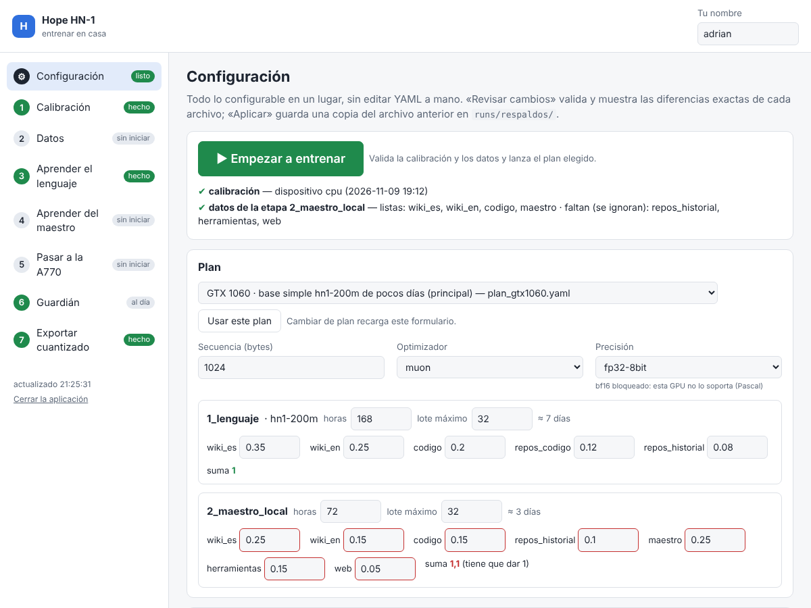
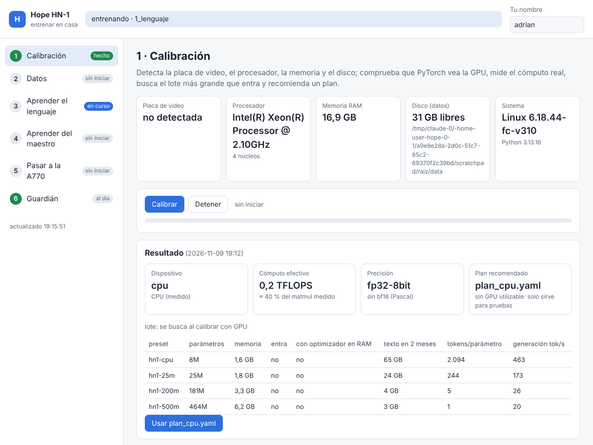

# Aplicación para entrenar a Hope en casa

Pedido del usuario: una aplicación con interfaz para dejar entrenando a Hope en la PC de casa
(GTX 1060 6 GB + i5-9400F + 16 GB de RAM, Windows 10/11) y después seguir en otra PC con una
Intel Arc A770.

Por decisión del usuario, la 1060 hace una **base simple de pocos días**: `plan_gtx1060.yaml`, con
hn1-200m, 120 h de lenguaje y 48 h de maestro local. El entrenamiento largo sigue en la A770 con
`plan_a770_continuacion.yaml`: crece a 500M con visión y termina con QAT en 4/8 bits.

```
python -m hope.app            # abre http://127.0.0.1:8765 en el navegador
```

- **Sin dependencias nuevas:**
  - servidor HTTP de la biblioteca estándar de Python;
  - una página propia (HTML, JS y CSS sin CDN);
  - gráficos en SVG hechos a mano.
- **Solo en tu PC:** escucha únicamente en `127.0.0.1`. No ejecuta comandos que lleguen desde la web, solo acciones de una lista fija (ver [Seguridad](#seguridad)).
- **Qué guarda:**
  - la configuración que elijas, en `runs/app.json`;
  - el plan efectivo que lanza, en `runs/planes/<plan>.yaml`. Es una copia del plan de `configs/` con las rutas de datos apuntando a tu carpeta.

Las capturas de esta guía son de una corrida de prueba en CPU con el modelo `hn1-tiny`. En la 1060 los números son otros, pero las pantallas son las mismas.

## Instalación

### Lo más simple: doble clic

| sistema | archivo | qué hace |
|---|---|---|
| Windows | **`Hope.bat`** | la primera vez instala todo en una ventana con el progreso; después abre la aplicación |
| Windows | **`Iniciar Hope.vbs`** | lo mismo, pero sin ventana de consola (la instalación sí se ve). Para cerrar: «Cerrar la aplicación» en la página |
| Windows | **`Hope.exe`** | lanzador con ícono (ver abajo cómo conseguirlo) |
| Linux | **`hope.sh`** | igual que `Hope.bat` |
| macOS | **`Hope.command`** | llama a `hope.sh` |

La primera vez:
- elige la variante de PyTorch según la placa de video: CUDA 12.6 si hay `nvidia-smi` (GTX 1060), XPU si hay una Intel Arc (A770), CPU si no hay ninguna;
- PyTorch pesa unos 2,5 GB: la instalación tarda varios minutos.

Si la aplicación ya estaba abierta, el doble clic solo abre el navegador.

Antes de la primera vez:
- instalar Python 3.10 o más nuevo desde python.org, marcando «Add python.exe to PATH»;
- instalar el driver de la placa (NVIDIA o Intel) más reciente.

### Hope.exe

`Hope.exe` es un lanzador liviano: **no trae PyTorch adentro**. Hace lo mismo que `Hope.bat`, con ícono y sin consola:
- busca la carpeta de Hope;
- si falta el entorno, busca un Python 3.10+ e instala todo. Si no hay Python, avisa y abre la página de descarga;
- arranca la aplicación.

**Cómo conseguirlo** (lo construye GitHub, no hace falta instalar nada):

1. En GitHub, pestaña **Actions** → **«Hope.exe para Windows»** → **Run workflow** → elegir la rama → **Run workflow**.
   - El workflow aparece en la lista una vez que `.github/workflows/exe_windows.yml` está en la rama por defecto del repositorio.
2. Cuando termina (unos minutos), abrir la ejecución y descargar el artefacto **`Hope-windows`** (queda 30 días).
3. Descomprimirlo. Adentro está la carpeta `Hope` con `Hope.exe` y todo el código.
4. Doble clic en `Hope.exe`.

El workflow construye con PyInstaller (`empaquetado/hope_app.spec`) y comprueba el lanzador con `Hope.exe --comprobar` antes de subirlo.

**Construirlo a mano** (en Windows):

```
pip install pyinstaller
python -m PyInstaller --noconfirm --clean empaquetado/hope_app.spec
```

Deja `dist/Hope.exe`, que se copia a la carpeta de Hope. El ícono se regenera con `python empaquetado/generar_icono.py`.

### Instalación a mano

**Windows (GTX 1060):** doble clic en **`instalar_windows.bat`**. El instalador:
- crea el entorno `.venv`;
- instala PyTorch con CUDA 12.6 (la variante que incluye `sm_61`, la arquitectura de la GTX 10xx);
- instala `numpy`, `pyyaml`, `pyarrow`, `sympy`, `pint` y `pytest`.

Después se abre con **`iniciar_hope.bat`**.

**Windows (A770):** `instalar_windows.bat a770`, que instala la variante XPU de PyTorch.

**Linux:**

```bash
./instalar_linux.sh          # GTX 10xx (cu126)
./instalar_linux.sh a770     # Intel Arc (xpu)
./iniciar_hope.sh
```

### Cerrar y volver a abrir

- **Cerrar la ventana** (o el botón «Cerrar la aplicación», abajo a la izquierda) cierra solo la interfaz.
- **Si el entrenamiento estaba en curso:**
  - al volver a abrir la aplicación, lo retoma solo (casilla «seguir solo al abrir la aplicación»);
  - si el proceso todavía estaba vivo, la aplicación lo «adopta» y lo sigue mostrando.
- **En Windows,** mientras entrena, la aplicación le pide al sistema que no suspenda la PC. La pantalla sí puede apagarse.

### Opciones

| opción | qué hace |
|---|---|
| `--puerto 8765` | otro puerto |
| `--raiz <carpeta>` | carpeta del proyecto (donde están `configs/` y `runs/`) |
| `--sin-navegador` | no abre el navegador |

## Los pasos

En la barra de la izquierda cada paso muestra su estado: sin iniciar, en curso, en pausa, terminada, hecho o error.

En cada paso hay:
- botones **Iniciar / Pausar / Reanudar**;
- una barra de progreso;
- el registro del paso.

Arriba a la derecha va **tu nombre**: queda en la auditoría del guardián cuando aprobás algo.

### ⚙ Configuración



Todo lo configurable en una pantalla, con formularios validados en lugar de editar YAML a mano.

**Qué se configura:**

| sección | archivo | validación |
|---|---|---|
| plan elegido, secuencia, optimizador, precisión | `configs/<plan>.yaml` | secuencia múltiplo de 64; optimizador `adamw` o `muon`; **bf16 bloqueado** si la calibración dice que la GPU no lo soporta (Pascal) |
| horas y lote máximo de cada etapa | `configs/<plan>.yaml` | números positivos; las etapas de crecimiento no tienen horas |
| pesos de las fuentes de cada etapa | `configs/<plan>.yaml` | entre 0 y 1, **tienen que sumar 1** (la suma se ve en vivo). Si ya venían mal en el archivo y no se tocan, es solo un aviso |
| carpeta de datos, maestro o tutor (endpoint, modelo, «Probar conexión») | `runs/app.json` | carpeta no vacía; el maestro tiene que ser local |
| reglas de la web | `configs/web.yaml` | **siempre solo lectura**: `acceso: solo_lectura` y métodos `GET`/`HEAD`; cualquier otro valor se rechaza. Modo (`desactivado`, `solo_lista`, `busqueda`), sitios permitidos y bloqueados (solo dominios), límites por hora, por día, por página y por pedido |
| cuota diaria de datos de la web | `configs/fuentes_web.yaml` | MB y páginas por día, carpeta, horario. Si el archivo no existe, se crea al aplicar |
| techo de parámetros del guardián | `configs/growth_budget.yaml` | frase exacta `AUTORIZO 500M`, tu nombre y auditoría del guardián (la misma función que `python -m guardian.cli limite`) |

**Cómo se guarda:**
1. **«Revisar cambios»** valida todo y muestra el **diff exacto** de cada archivo, sin escribir nada.
2. **«Aplicar estos cambios»** (con confirmación) guarda una **copia de seguridad** del archivo anterior en `runs/respaldos/<fecha>_<archivo>` y escribe.
   - Los YAML se editan **por línea**: cambia solo el valor y se conservan los comentarios.
   - Si el entrenamiento está corriendo, los cambios del plan valen al reanudar.

**«▶ Empezar a entrenar»** comprueba antes de lanzar el plan:
- que la calibración esté hecha y PyTorch vea la GPU;
- que la etapa que sigue tenga al menos una fuente de datos construida (las que faltan se ignoran);
- en la A770, que exista el checkpoint de origen.

Si algo falta, dice qué y en qué paso se arregla.

### 1 · Calibración



**Qué detecta:**
- placa de video (con `nvidia-smi`);
- procesador, RAM, disco libre y sistema.

**«Calibrar»** corre `python -m hope.app.calibrar` como subproceso, así la GPU queda libre al terminar. Hace cuatro cosas:

1. **Revisa PyTorch.** Si hay una GTX 10xx pero la instalación no incluye `sm_61`, o PyTorch no ve CUDA, muestra el comando exacto para corregirlo:

   ```
   pip install --force-reinstall torch --index-url https://download.pytorch.org/whl/cu126
   ```

   En una A770 sin XPU muestra el equivalente con `whl/xpu`.
2. **Mide el cómputo efectivo** con `hope.bench.hardware.calibrate`. El perfil supuesto (ancho de banda, etc.) se elige por el modelo de la GPU.
3. **Busca el lote máximo** del plan elegido, con su precisión (`fp32-8bit`) y con el optimizador en la RAM.
4. **Recomienda un plan** y muestra la tabla de `recommend`: memoria, si entra, si entra con el optimizador en la RAM, texto que alcanza a ver en 2 meses, tokens por parámetro y velocidad de generación.
   - Con una GPU NVIDIA: `plan_gtx1060.yaml`, la base simple con hn1-200m.
   - `plan_gtx1060_500m_vision.yaml` (500M con visión, con el optimizador en la RAM) queda como opción manual. Es mucho más lento; si al calibrarlo no entra ni con lote 1, se recomienda la base de 200M.
   - Con XPU y un entrenamiento importado: `plan_a770_continuacion.yaml`.

Abajo se puede elegir el plan a mano. «Usar *plan*» lo guarda.

### 2 · Datos


**Qué se configura:**
- la carpeta de datos (por defecto `data`);
- el presupuesto total en GB;
- el reparto entre fuentes.

**Fuentes:** cada una queda en `<carpeta>/pre/<fuente>`, que son las rutas que leen los planes.

| fuente | de dónde sale |
|---|---|
| `wiki_es`, `wiki_en` | Wikipedia (Parquet de Hugging Face, CC BY-SA). Se descarga por partes con progreso y se guarda en `<carpeta>/raw/wiki`: no se vuelve a bajar |
| `codigo` | la biblioteca estándar de Python de la instalación + carpetas de código que agregues |
| `repos_codigo`, `repos_historial` | tus repositorios git (`hope.data.repos`): el código actual y el historial de commits como episodios «problema → corrección». **Los commits con coautoría de una IA se excluyen por defecto.** La casilla para incluirlos explica por qué: los términos de uso de varios proveedores restringen entrenar otros modelos con sus salidas. «Solo el historial de este autor» sirve para forks |
| `propias` | libros, manuales y apuntes (txt, md, html, código; PDF si está `pdftotext`) |

**Calidad:**
- Todas las fuentes pasan las reglas de calidad de `hope.data.quality`, salvo el historial de commits: un diff no «parece» prosa, pero es valioso.
- Si indicás un modelo `.npz` de `hope.data.quality`, la prosa por debajo del umbral también se descarta.

**Progreso y pausa:**
- La tabla muestra el progreso de cada fuente: GB escritos sobre el presupuesto, documentos, descartados y duplicados.
- **Pausar** deja hechas las fuentes terminadas. Al reanudar se rehace solo la que quedó a medias; las partes de Wikipedia ya bajadas no se vuelven a descargar.
- «Rehacer todo» (pide confirmación) empieza de cero.

### 3 · Aprender el lenguaje


**«Iniciar»** lanza `python -m hope.train.run --plan runs/planes/<plan>.yaml` como subproceso.
- La salida va a `runs/hope/salida_app.log`.
- El pid queda en `runs/app_entrenamiento.json`.

**Detener:**
- **Pausar** crea `runs/hope/DETENER`. `hope.train.run` lo mira después de cada checkpoint (cada 30 minutos) y termina ahí, sin perder nada. Al reanudar, sigue desde ese checkpoint.
- **Detener ya** (pide confirmación) corta el proceso en el momento: se pierde lo hecho desde el último checkpoint.

**Retoma automática:**
- Si el proceso se cae (error, falta de memoria, corte), la aplicación lo relanza sola tras 30 s, 60 s, 90 s… hasta 5 veces seguidas. El contador vuelve a cero si corrió más de 30 minutos.
- Como `hope.train.run` guarda su estado en `estado.json`, siempre sigue donde quedó.

**Panel** (todo sale de `registro.jsonl` y `estado.json`):
- etapas del plan con sus horas;
- etapa actual y tiempo que le falta (ETA);
- horas entrenadas, bytes por segundo, lote y paso;
- memoria, uso y temperatura de la GPU (con `nvidia-smi`; avisa si pasa de 83 °C);
- curva de **bits por byte en validación por fuente**, con líneas verticales en los cambios de etapa.

**Muestra de lo que escribe:**
- Con cada checkpoint (o con «Generar ahora»), un subproceso carga `runs/hope/ligero.pt` con `load_light` y continúa tres textos: uno en español, uno en inglés y uno de código.
- Corre en la CPU con 2 hilos, así no le quita la GPU al entrenamiento.
- Se guardan las últimas 20 en `runs/hope/muestras.json`.

### 4 · Aprender del maestro


**El maestro** es un modelo local con la API de OpenAI:
- llama.cpp: `llama-server -m qwen.gguf --port 8080` → `http://127.0.0.1:8080/v1`;
- Ollama: `ollama serve` → `http://127.0.0.1:11434/v1`.

Se recomienda Qwen con licencia Apache 2.0.
- **Con la base de 200M en la 1060:** el entrenamiento usa ~3–4 GB, así que un **Qwen2.5 1,5B Instruct cuantizado** (Q4_K_M, ~1,1 GB) entra en la misma GPU. Por ejemplo: `llama-server -m qwen2.5-1.5b-instruct-q4_k_m.gguf --port 8080 -ngl 99 -c 4096`. La página lo sugiere.
- **Con el plan de 500M con visión:** no hay lugar en la GPU, así que el maestro corre en la CPU (`-ngl 0`). La configuración se guarda también en `runs/maestro.yaml`, con el formato de `configs/teacher.yaml`.

**«Probar conexión»:** pide la lista de modelos y una respuesta mínima. Avisa si el servidor no lista el modelo configurado.
- Solo acepta servidores locales. Un maestro remoto sale a la red y necesita aprobación del guardián desde la línea de comandos.

**«Generar episodios»** recorre `configs/curriculum.yaml`:
- **Pedido:** a cada tema le pide al maestro N episodios (problema resuelto paso a paso).
- **Verificación:** los verifica con las herramientas (`hope.tools.verify`).
  - **Aceptado:** todos los pasos verificables pasan. Con la casilla marcada, también los que no tienen nada verificable (pesan menos).
  - **Rechazado:** algún paso falla. No se entrena con él.
  - **Inválido:** la respuesta no tiene el formato pedido.
- **Generadores:** suma episodios de los generadores verificables (gratis, sin maestro).

Todo queda en `<carpeta>/maestro/episodios.jsonl`, con el resultado de cada paso. Los aceptados se escriben en `<carpeta>/maestro/train.bin` y `val.bin`: es la fuente `maestro` de la etapa 2.
- Se puede generar mientras la GPU hace la etapa 1.
- Pausar y reanudar no repite episodios.

**Etapa 2:**
- Empieza sola cuando la etapa 1 cumple sus horas.
- «Pasar a la etapa del maestro ahora» (con el entrenamiento en pausa y confirmación) marca la etapa 1 como terminada en `estado.json` y relanza el entrenamiento.

### 5 · Pasar a la A770


**En la PC de la 1060 — «Empaquetar»** (con el entrenamiento en pausa) arma `runs/exportar/hope_para_a770_<fecha>.zip`.

Lleva:
- `runs/hope` entero: checkpoints, `estado.json`, `registro.jsonl`, `ligero.pt` y muestras;
- `data/maestro`;
- `configs/plan_a770_continuacion.yaml`;
- `LEEME_A770.txt` con las instrucciones;
- una marca de continuación.

Los pesos van sin comprimir (no se comprimen y así es rápido). El corpus no va: pesa decenas de GB. En la A770 se reconstruye con el paso 2, o se copia la carpeta aparte.

**En la PC de la A770:**

1. Instalar con `instalar_windows.bat a770`, abrir la aplicación, ir al paso 5, escribir la ruta del .zip e **«Importar»**.
   - Solo se extraen rutas dentro de `runs/hope/` y `data/maestro/`; las entradas con `..` se ignoran.
   - No pisa un entrenamiento propio de esa PC.
2. La aplicación **detecta que es una continuación**:
   - muestra un aviso arriba;
   - elige `plan_a770_continuacion.yaml`;
   - el plan efectivo apunta `desde:` al último checkpoint real (de la etapa 1 o de la 2, el que haya).
3. Calibrar (debe decir `xpu`), reconstruir los datos y «Iniciar».
   - Los pesos fp32 de la 1060 pasan solos a bf16.
   - Si el modelo vino con 200M, la etapa 3 pide crecer a 500M: aparece en el paso 6.

### 6 · Guardián


**Qué muestra:**
- el techo de parámetros, el modo y el umbral de cambio importante;
- si la auditoría está íntegra.

**Solicitudes pendientes:** se aprueban o deniegan con una nota opcional, con tu nombre. Usa las mismas funciones que `python -m guardian.cli approve/deny`.
- Si la solicitud la hizo el programa de entrenamiento (crecer), la aplicación anota la aprobación en `estado.json`. Al reanudar, la etapa sigue sin editar nada a mano.

**Subir el techo de parámetros:**
- Pide confirmación explícita: hay que escribir `AUTORIZO 500M` (o el valor que corresponda) y aceptar un segundo aviso.
- Queda en la auditoría.
- El techo es un máximo autorizado, no una meta.

### 7 · Exportar cuantizado

Guarda a Hope con los pesos en **4 u 8 bits** para usarlo. Usa el último `ligero.pt`: el de `runs/hope_a770` o el de `runs/hope`, el más reciente. Se puede probar en cualquier momento, también a mitad del entrenamiento.

**«Exportar»** corre `python -m hope.app.cuantizar` como subproceso en la CPU:
1. carga el modelo con `load_light`;
2. cuantiza las capas lineales con `hope.core.fast.quantize(model, bits)`, por grupos de 64, igual que el QAT de `hope.train.qat`;
3. guarda el resultado en `runs/exportar/hope_q4_<fecha>.pt`.

**La tabla de exportados muestra:**
- el tamaño del archivo frente al modelo ligero en bf16. En 4 bits las capas lineales ocupan ~0,56 bytes por peso;
- la **pérdida en un texto de prueba antes y después de cuantizar**. Si el plan terminó con QAT, casi no cambia;
- una muestra de texto del modelo cuantizado.

El archivo se vuelve a abrir con `hope.app.cuantizar.cargar(ruta)`; la aplicación lo comprueba al exportar.

### 8 · Datos diarios

Deja corriendo `python -m hope.data.web_sources --diario --repetir`: una vez por día trae la cuota de datos de fuentes legales (Wikipedia por sus descargas oficiales, Wikilibros, arXiv, CORE, Gutenberg…), la filtra por calidad, la deduplica y la suma al corpus con su licencia. La tabla muestra cada fuente, su método, su licencia y lo que trajo el último día.

- Las fuentes, la cuota (GB y documentos por día) y las licencias aptas para entrenar se eligen en `configs/fuentes_web.yaml`.
- Los permisos de red, en `configs/web.yaml`: con `modo: preguntar` cada acceso aparece en el paso 6 para aprobar; con `lista_permitida`, los dominios de la lista quedan aprobados.
- Todo es de solo lectura y con un bot identificado. Detalle en [docs/resultados/fuentes_legales.md](resultados/fuentes_legales.md).

## Seguridad

- **Solo local:** el servidor escucha en `127.0.0.1` y rechaza pedidos cuyo `Host` no sea `127.0.0.1` o `localhost`. Eso protege contra «DNS rebinding».
- **Acciones protegidas:** van por `POST /api/accion` y exigen el encabezado `X-Hope: 1` con cuerpo JSON. Una página de otro sitio no puede mandar eso sin permiso CORS, y este servidor nunca lo da.
- **Lista fija:** solo existen las acciones de `ACCIONES` en `hope/app/server.py`.
  - Ninguna ejecuta comandos.
  - Los subprocesos son siempre módulos fijos de Hope: `hope.train.run`, `hope.app.calibrar`, `hope.app.muestra` y `hope.app.cuantizar`.
  - `guardar_config` solo acepta las claves de `EDITABLES`, con su tipo.
  - El plan tiene que llamarse `plan_*.yaml` y estar en `configs/`.
- **Confirmación** para lo destructivo o importante: detener sin esperar el checkpoint, rehacer los datos, saltar de etapa, aplicar la configuración (después de ver el diff), cerrar la aplicación y subir el techo (frase exacta).
- **Web solo de lectura:** la configuración nunca deja escribir en la red (ni `acceso` distinto de `solo_lectura` ni métodos distintos de GET/HEAD).
- **Encabezados:** la página se sirve con una política de contenido que solo permite scripts propios.

## Archivos

| archivo | qué es |
|---|---|
| `hope/app/server.py` | servidor, estado completo (`GET /api/estado`) y lista de acciones |
| `hope/app/config.py` | `runs/app.json` y plan efectivo en `runs/planes/` |
| `hope/app/tareas.py` | tareas de fondo con pausa cooperativa; subprocesos de módulos fijos |
| `hope/app/calibrar.py` | calibración (subproceso) |
| `hope/app/datos.py` | construcción de las fuentes |
| `hope/app/entrenamiento.py` | proceso de entrenamiento, pausa, retoma, métricas, muestras |
| `hope/app/muestra.py` | muestras de generación (subproceso en CPU) |
| `hope/app/maestro.py` | maestro local, prueba de conexión y episodios verificados |
| `hope/app/migrar.py` | empaquetar e importar para la A770 |
| `hope/app/guardian_app.py` | guardián |
| `hope/app/ajustes.py` | pantalla de Configuración: validación, diff, copias de seguridad, «Empezar a entrenar» |
| `Hope.bat`, `Iniciar Hope.vbs`, `hope.sh`, `Hope.command` | doble clic |
| `empaquetado/` | lanzador de `Hope.exe`, spec de PyInstaller, ícono |
| `.github/workflows/exe_windows.yml` | construye `Hope.exe` en GitHub (manual) |
| `hope/app/cuantizar.py` | exportar a 4/8 bits y volver a abrir (subproceso en CPU) |
| `hope/app/static/` | la página |
| `instalar_windows.bat`, `instalar_linux.sh`, `iniciar_hope.*` | instalación y arranque |
| `tests/test_app.py` | pruebas: API, pasos, plan de juguete con `hn1-tiny` en CPU (lanzar, pausar, retomar, caída y relanzamiento), maestro simulado, .zip ida y vuelta, guardián, exportación a 4 bits, configuración (validación, copias, web solo lectura, techo auditado), «Empezar a entrenar», lanzador |
