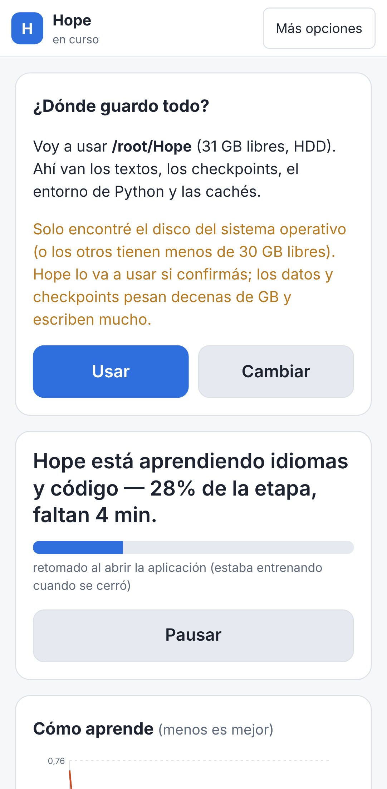
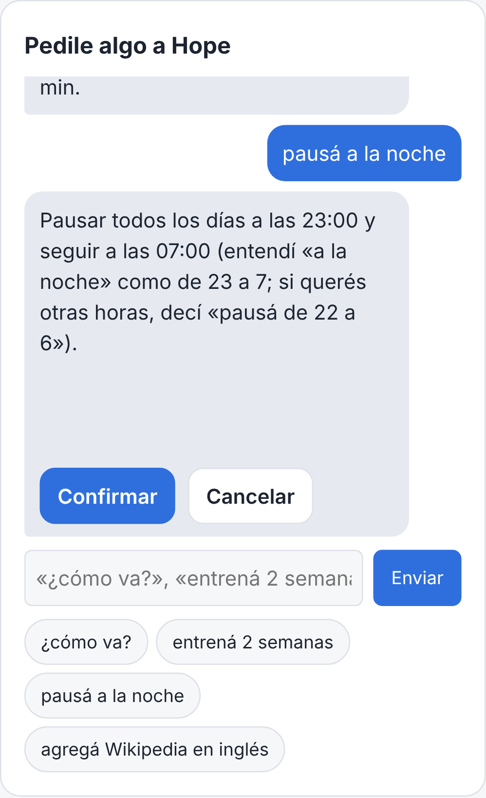
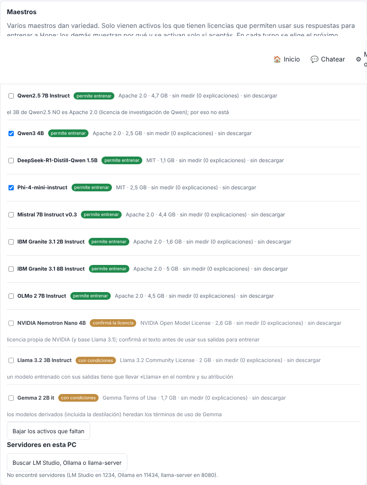
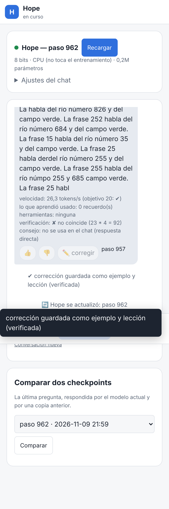
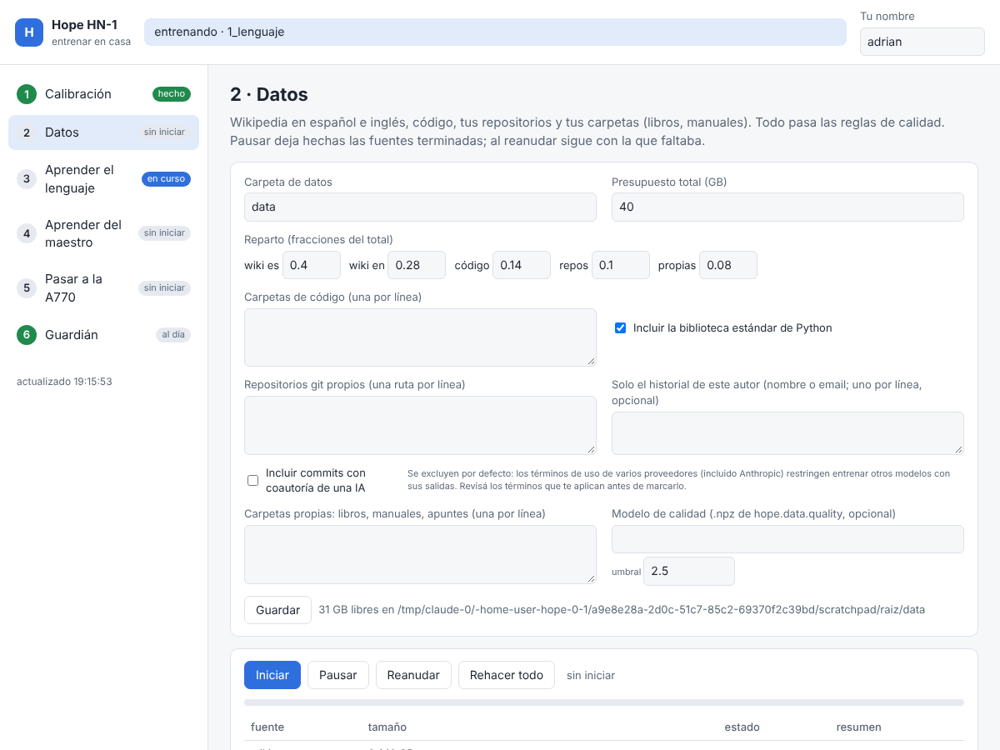
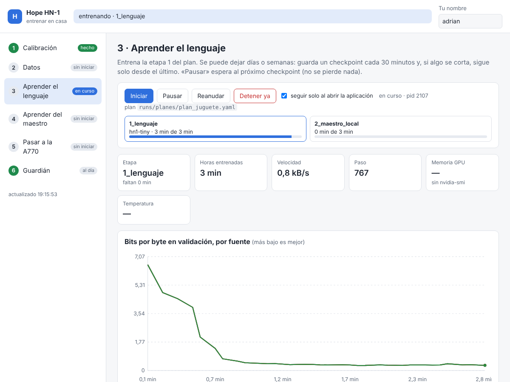
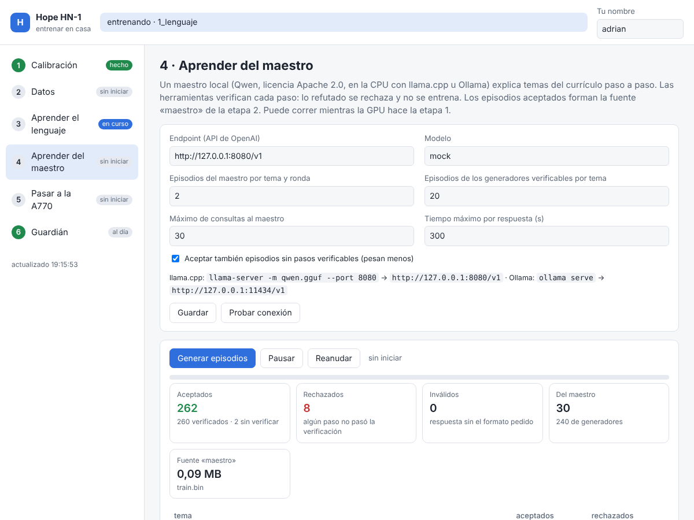
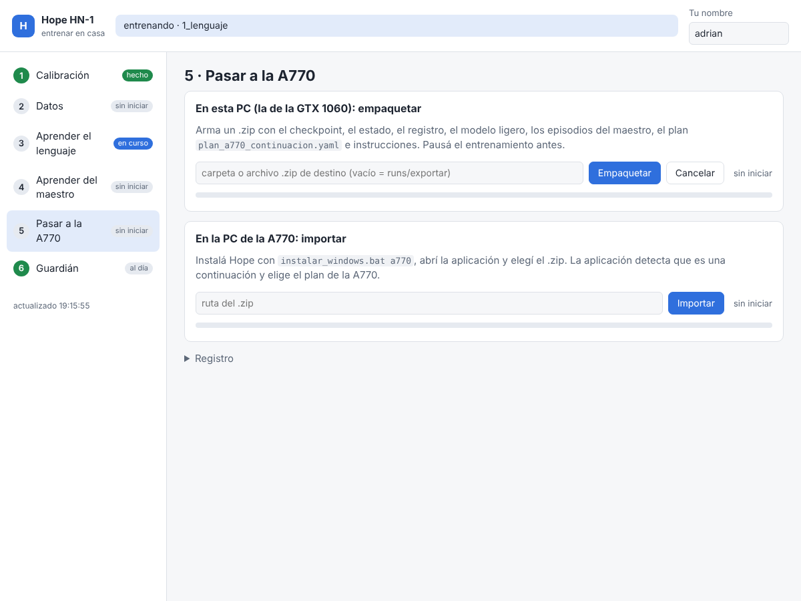
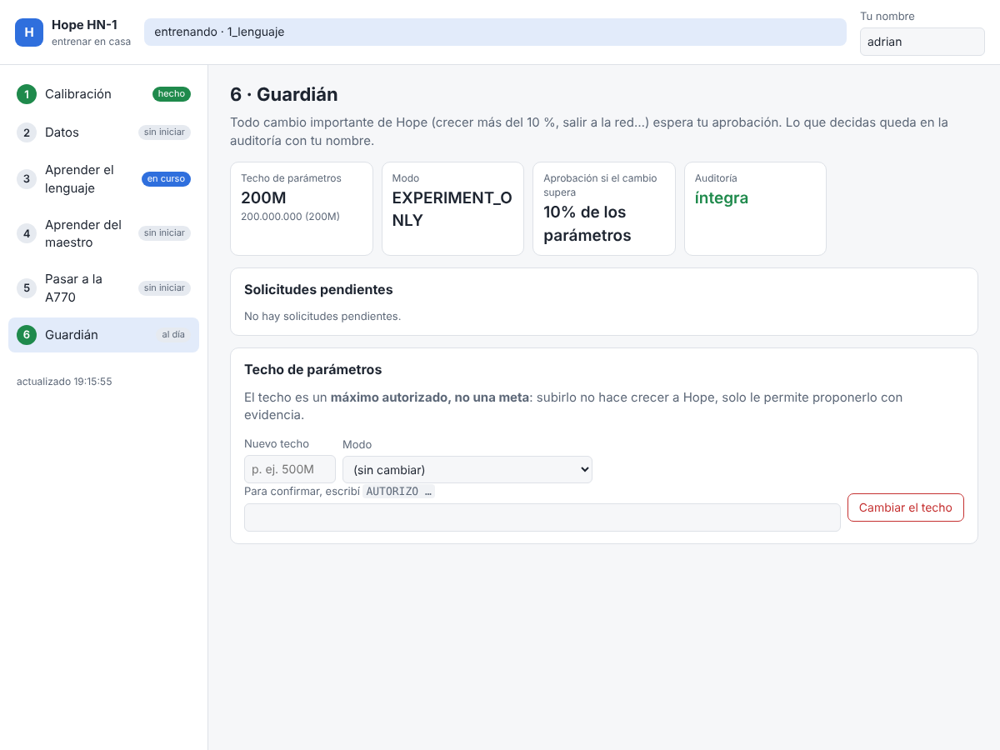

# Aplicación para entrenar a Hope en casa

Pedido del usuario: una aplicación con interfaz para dejar entrenando a Hope en la PC de casa
(GTX 1060 6 GB + i5-9400F + 16 GB de RAM, Windows 10/11) y después seguir en otra PC con una
Intel Arc A770. «Lo más automático posible», «que no toque el SSD del sistema operativo» y «simple, como una
app de celular».

Por decisión del usuario, la 1060 hace una **base simple de pocos días**: `plan_gtx1060.yaml`, con
hn1-200m, 120 h de lenguaje y 48 h de maestro local. El entrenamiento largo sigue en la A770 con
`plan_a770_continuacion.yaml`: crece a 500M con visión y termina con QAT en 4/8 bits.

```
python -m hope.app            # abre http://127.0.0.1:8765 en el navegador
```

- **Sin dependencias nuevas:**
  - servidor HTTP de la biblioteca estándar de Python;
  - una página propia (HTML, JS y CSS sin CDN);
  - gráficos en SVG hechos a mano.
- **Solo en tu PC:** escucha únicamente en `127.0.0.1`, salvo que actives «Usar desde el celular» (con PIN). No ejecuta comandos que lleguen desde la web, solo acciones de una lista fija (ver [Seguridad](#seguridad)).
- **Qué guarda:**
  - la configuración que elijas, en `runs/app.json`;
  - el plan efectivo que lanza, en `runs/planes/<plan>.yaml`. Es una copia del plan de `configs/` con las rutas de datos apuntando a tu carpeta.

Las capturas de esta guía son de una corrida de prueba en CPU con el modelo `hn1-tiny`. En la 1060 los números son otros, pero las pantallas son las mismas.

## Instalación

### Lo más simple: doble clic

| sistema | archivo | qué hace |
|---|---|---|
| Windows | **`Hope.bat`** | la primera vez instala todo en una ventana con el progreso; después abre la aplicación |
| Windows | **`Iniciar Hope.vbs`** | lo mismo, pero sin ventana de consola (la instalación sí se ve). Para cerrar: «Cerrar la aplicación» en la página |
| Windows | **`Hope.exe`** | lanzador con ícono (ver abajo cómo conseguirlo) |
| Linux | **`hope.sh`** | igual que `Hope.bat` |
| macOS | **`Hope.command`** | llama a `hope.sh` |

La primera vez:
1. **Elige el disco** (ver [Dónde guarda todo](#dónde-guarda-todo)) y pide confirmar con Enter.
2. **Elige la variante de PyTorch** según la placa de video: CUDA 12.6 si hay `nvidia-smi` (GTX 1060), XPU si hay una Intel Arc (A770), CPU si no hay ninguna.
3. **Instala.** PyTorch pesa unos 2,5 GB, así que tarda varios minutos. El entorno y la caché de pip van al disco elegido.

Si la aplicación ya estaba abierta, el doble clic solo abre el navegador.

Antes de la primera vez:
- instalar Python 3.10 o más nuevo desde python.org, marcando «Add python.exe to PATH»;
- instalar el driver de la placa (NVIDIA o Intel) más reciente.

### Hope.exe

`Hope.exe` es un lanzador liviano: **no trae PyTorch adentro**. Hace lo mismo que `Hope.bat`, con ícono y sin consola:
- busca la carpeta de Hope;
- si falta el entorno, busca un Python 3.10+ e instala todo. Si no hay Python, avisa y abre la página de descarga;
- arranca la aplicación.

**Cómo conseguirlo** (lo construye GitHub, no hace falta instalar nada):

1. En GitHub, pestaña **Actions** → **«Hope.exe para Windows»** → **Run workflow** → elegir la rama → **Run workflow**.
   - El workflow aparece en la lista una vez que `.github/workflows/exe_windows.yml` está en la rama por defecto del repositorio.
2. Cuando termina (unos minutos), abrir la ejecución y descargar el artefacto **`Hope-windows`** (queda 30 días).
3. Descomprimirlo. Adentro está la carpeta `Hope` con `Hope.exe` y todo el código.
4. Doble clic en `Hope.exe`.

El workflow construye con PyInstaller (`empaquetado/hope_app.spec`) y comprueba el lanzador con `Hope.exe --comprobar` antes de subirlo.

**Construirlo a mano** (en Windows):

```
pip install pyinstaller
python -m PyInstaller --noconfirm --clean empaquetado/hope_app.spec
```

Deja `dist/Hope.exe`, que se copia a la carpeta de Hope. El ícono se regenera con `python empaquetado/generar_icono.py`.

### Instalación a mano

**Windows (GTX 1060):** doble clic en **`instalar_windows.bat`**. El instalador:
- crea el entorno `.venv`;
- instala PyTorch con CUDA 12.6 (la variante que incluye `sm_61`, la arquitectura de la GTX 10xx);
- instala `numpy`, `pyyaml`, `pyarrow`, `sympy`, `pint` y `pytest`.

Después se abre con **`iniciar_hope.bat`**.

**Windows (A770):** `instalar_windows.bat a770`, que instala la variante XPU de PyTorch.

**Linux:**

```bash
./instalar_linux.sh          # GTX 10xx (cu126)
./instalar_linux.sh a770     # Intel Arc (xpu)
./iniciar_hope.sh
```

### Cerrar y volver a abrir

- **Cerrar la ventana** (o el botón «Cerrar la aplicación», abajo a la izquierda) cierra solo la interfaz.
- **Si el entrenamiento estaba en curso:**
  - al volver a abrir la aplicación, lo retoma solo (casilla «seguir solo al abrir la aplicación»);
  - si el proceso todavía estaba vivo, la aplicación lo «adopta» y lo sigue mostrando.
- **En Windows,** mientras entrena, la aplicación le pide al sistema que no suspenda la PC. La pantalla sí puede apagarse.

### Opciones

| opción | qué hace |
|---|---|
| `--puerto 8765` | otro puerto |
| `--raiz <carpeta>` | carpeta del proyecto (donde están `configs/` y `runs/`) |
| `--sin-navegador` | no abre el navegador |

## Dónde guarda todo

Nada pesado va al disco del sistema operativo (`hope/app/discos.py`).

**Cómo elige el disco:**
- **Detecta los discos:**
  - en Windows, las letras de unidad con su espacio libre y tipo (HDD, SSD o externo, según `Get-PhysicalDisk`);
  - en Linux, los puntos de montaje y si el disco gira.
- **Excluye el del sistema:** la unidad de `%SystemDrive%`, o la de `/`.
- **Elige** el disco con más espacio libre, prefiriendo un HDD o un disco externo, y propone `<disco>\Hope` en una sola pantalla: «Voy a usar D:\Hope (1.800 GB libres). [Usar] [Cambiar]».
- **Si solo está el disco del sistema,** lo dice claramente y pide confirmar igual.

**Qué va ahí:**

| qué | cómo |
|---|---|
| entorno de Python (`.venv`), checkpoints y registros (`runs/`), textos (`data/`) | uniones de directorios (Windows) o enlaces (Linux) desde la carpeta del proyecto; lo que ya había se mueve |
| caché de pip, de Hugging Face (`HF_HOME`), de PyTorch (`TORCH_HOME`), `XDG_CACHE_HOME` | variables de entorno que la aplicación y los lanzadores ponen antes de instalar o entrenar |
| temporales (`TMP`, `TEMP`, `TMPDIR`) | idem |
| modelo del maestro (GGUF) y llama.cpp | `<carpeta>/modelos` |
| episodios del maestro y base de conocimiento SQLite | dentro de `data/` y `runs/` |
| estado del optimizador si no alcanza la RAM | `offload_optimizador: disco` en el plan: archivos mapeados en memoria en `<carpeta>/runs/optimizador_en_disco` (el sistema trae a la RAM solo lo que se usa) |

**Dónde queda la elección:**
- se guarda en `hope_ubicacion.json`, un archivo chico en la carpeta del proyecto;
- se cambia en **Más opciones → Configuración → Disco**.

**Un entorno de Python que ya existía no se mueve**, porque se rompería. Para pasarlo al disco elegido, borrá `.venv` y abrí Hope de nuevo.

## La pantalla de inicio

| celular | chat |
|---|---|
|  |  |

**Qué muestra:**
- **Estado en una frase:** por ejemplo «Hope está aprendiendo idiomas y código — 34 % de la etapa, faltan 4 días», con una barra.
- **Un botón grande:** **Empezar (automático)**, **Pausar** o **Continuar**, según el momento.
- **Una tarjeta** con la curva de aprendizaje y lo último que escribió.
- **El chat de control.**

Abajo (en el celular) o arriba (en la PC) hay tres pestañas:
- **🏠 Inicio**;
- **💬 Chatear**;
- **⚙ Más opciones:** los pasos y la Configuración.

El diseño es para el celular primero:
- textos grandes y botones de 44 px o más;
- modo oscuro automático;
- sin dependencias externas.

### Empezar (automático)

Encadena, sin intervención (`hope/app/automatico.py`). **Qwen va desde el principio** (decisión del usuario):

1. **Dependencias:** instala las que falten, de una lista fija.
2. **Calibración:** mide la PC y elige el plan recomendado.
3. **Maestro:**
   - baja Qwen2.5-1.5B-Instruct Q4_K_M (Apache 2.0, ~1,1 GB, con verificación SHA-256) y el paquete de llama.cpp de la última versión (CUDA para la 1060, Vulkan para la Arc, CPU si no hay GPU);
   - arranca `llama-server` en 127.0.0.1: **en la GPU** si entra junto al entrenamiento (plan de 200M con 6 GB o más), si no **en la CPU** (plan de 500M con visión);
   - **Qwen empieza a explicar ahí mismo y no para.** Genera episodios verificados en modo continuo; el máximo de consultas pasa a ser por día. Si `hope.teacher.harvest` tiene `--continuo`, se usa ese.

   Si algo de esto falla, Hope entrena igual y lo avisa.
4. **Textos:** baja Wikipedia en español e inglés y el código. El presupuesto sale del espacio libre: hasta 40 GB, nunca más de un tercio de lo libre.
5. **Calidad:** las reglas de calidad se aplican al construir los textos.
6. **Entrenar:** lanza el plan.

**Qwen mientras Hope entrena:**
- La etapa 1 de `plan_gtx1060.yaml` ya incluye `maestro: data/maestro:0.20`.
- `hope.train.run` **vuelve a leer las fuentes en cada tramo** de 30 minutos: lo que Qwen explica entra solo, sin reiniciar. Mientras `data/maestro` esté vacía, o con `val.bin` de menos de 1 KB, se ignora.
- En Inicio se ve «Qwen está explicando: N explicaciones hoy, M aceptadas por la verificación».
- Se prende y se apaga en Más opciones → Configuración → Qwen, el maestro.
- Al volver a abrir la aplicación, el maestro y las explicaciones arrancan solos.

**«Qwen lee junto a Hope»** (destilación de probabilidades de Qwen, precalculadas) tiene su lugar en la configuración. Queda deshabilitado hasta que llegue la rama de tokens.

**Cómo se comporta:**
- **Progreso:** se ve paso a paso.
- **Retoma:** lo hecho no se repite y las descargas cortadas siguen desde donde quedaron.
- **Espacio:** antes de cada paso se comprueba el espacio libre; si no alcanza, pausa con un aviso.
- **Disco lleno durante el entrenamiento:** con menos de 3 GB libres, pausa después del próximo checkpoint.
- **Al volver a abrir la aplicación:** el maestro que quedó listo se arranca solo.

### Chat de control

Escribís en castellano y Hope lo traduce a un comando de una **lista fija** (`hope/app/comandos.py`).

**Ejemplos de frases:**

| frase | qué hace |
|---|---|
| «¿cómo va?» | contesta el estado (no cambia nada) |
| «empezá», «pausá», «seguí» | empezar en automático, pausar, continuar |
| «entrená 2 semanas», «entrená 3 días» | duración total de la etapa actual (muestra el diff del plan) |
| «pausá a la noche», «pausá de 22 a 6», «sacá el horario» | horario diario de pausa |
| «agregá Wikipedia en inglés», «quitá el código» | fuentes de texto |
| «usá 60 GB de texto» | presupuesto de texto |
| «usá 1B de parámetros» | parámetros disponibles (**sensible**: frase `AUTORIZO 1B`, auditado) |
| «activá la web» / «desactivá la web» | reglas de la web, siempre solo lectura (**sensible**: frase `ACTIVAR WEB`) |
| «exportá en 4 bits», «calibrá de nuevo» | exportar cuantizado, volver a medir |

**Qué hace con cada frase:**
- **Antes de aplicar,** muestra qué va a cambiar y pide **Confirmar**; nada se aplica antes.
- **Frases ambiguas** («entrená más», «agregá Wikipedia», «pausá y exportá»): pregunta.
- **Lo que no está en la lista** («borrá todo», «abrí una terminal»): contesta qué se puede pedir y no hace nada.
- **Las rutas de carpetas no se toman desde el chat:** se escriben en Más opciones.

El intérprete es por reglas y palabras clave; no usa el maestro. Interpretar con el maestro local queda para más adelante.

### Varios maestros y turnos en la GPU



Pedido del usuario: varios maestros para tener variedad de datos, alternados con el entrenamiento en la GPU
(`hope/app/maestros.py`, `hope/app/turnos.py`, `configs/catalogo_maestros.yaml`).

**Catálogo de maestros.** Modelos GGUF Q4_K_M que la app baja desde Hugging Face:
- con reanudación y verificación SHA-256, al disco elegido;
- corren con `llama-server`, que la app controla;
- cada uno muestra su licencia, su tamaño, si entra en la GPU y el «% verificado» medido.

| grupo | modelos | por defecto |
|---|---|---|
| licencia que permite entrenar con sus respuestas | Qwen2.5 1.5B y 7B, Qwen3 4B (Apache 2.0); DeepSeek-R1-Distill-Qwen 1.5B, Phi-4-mini (MIT); Mistral 7B v0.3, IBM Granite 3.1 2B y 8B, OLMo 2 7B (Apache 2.0) | activos: Qwen2.5 1.5B, Qwen3 4B, Phi-4-mini |
| licencia propia: confirmá el texto | NVIDIA Nemotron Nano 4B (NVIDIA Open Model License) | desactivado hasta confirmar |
| condiciones sobre modelos derivados | Llama 3.2 3B (el modelo entrenado tiene que llevar «Llama» en el nombre y su atribución), Gemma 2 2B (los derivados heredan sus términos) | desactivados; se activan solo si aceptás |

**Qué cuidar:**
- **Qwen2.5 3B no está** porque no es Apache 2.0.
- **Repo y archivo de cada modelo:** antes de bajar se comprueba que existan; si no, se saltea con un aviso.
- **Tamaño:** los que no entran en la VRAM ni en su turno no se bajan. En una 1060 de 6 GB entra hasta ~7B en Q4.
- **Liberar disco:** «borrar el archivo» borra el GGUF de un maestro desactivado.

**Servidores que ya tengas.** «Buscar» prueba con `GET /v1/models`:
- LM Studio (127.0.0.1:1234);
- Ollama (11434);
- llama-server (8080).

Muestra sus modelos y con un toque los agrega como maestro, revisando antes la licencia.

En el **modo automático**, si encuentra LM Studio, **pregunta** si usarlo como maestro sin bajar nada más («Sí, usar LM Studio» / «No, bajar los maestros»). Si existe `configs/maestros.yaml` (de la rama maestro-local), también lo lee.

**Turnos (predeterminado).** Hope y el maestro se **alternan** la GPU, no la comparten:
1. **Hope entrena 45 min.**
2. **Pausa segura:** espera al próximo checkpoint y libera la VRAM.
3. **Turno del maestro, 15 min,** con toda la GPU y varios pedidos a la vez.
4. **Libera la GPU:** detiene `llama-server` o, en LM Studio, `lms unload --all`.
5. **Vuelve Hope,** que ya lee las explicaciones nuevas en ese tramo.

**Detalles de los turnos:**
- **Qué maestro sigue:** round-robin ponderado por la tasa de verificación de cada uno. Todos explican y los que más aciertan, más seguido; en empate, el que tuvo menos turnos.
- **Registro:** cada explicación queda con su maestro.
- **Proporción automática:** después de cada turno se estima cuántas veces repasaría Hope las explicaciones con ~20 % de maestro en la mezcla. Si las repetiría más de 3 veces por turno, el turno del maestro se alarga; si sobran, se acorta.
- **En Inicio** se ve «Turno de Hope: aprendiendo — 12 de 45 min» o «Turno de Qwen3 4B: explicando — 8 de 15 min».
- **LM Studio:** para sacar el modelo de la GPU hace falta su comando `lms`. Si no está, la app avisa: dejá el modelo en la CPU o bajá su «GPU offload», o usá los maestros del catálogo, que la app controla.
- **Modo «a la vez»** (opcional): el maestro queda cargado junto al entrenamiento. La app estima si entran, por ejemplo Nemotron 4B Q4 ≈ 3,2 GB más Hope 200M ≈ 3,5 GB, que no entran en 6 GB. Si no entran, recomienda bajar el «GPU offload» de LM Studio o usar turnos.

**Destilación («Qwen lee junto a Hope»):** usa llama.cpp, que da las probabilidades completas de cada palabra; LM Studio no siempre las expone.

### Chatear con Hope



La pestaña **💬 Chatear** sirve para hablar con Hope y probarlo **mientras entrena**, sin molestar al entrenamiento
(`hope/app/charla.py`, `hope/app/charla_app.py`).

**Cómo carga el modelo:**
- **Copia del último checkpoint.** Copia `ligero.pt` a `runs/hope/charla/paso_<N>.pt` y carga esa copia en un proceso aparte, nunca el archivo que escribe el entrenamiento. `ligero.pt` se escribe de forma atómica.
- **Dónde corre:** por defecto en la **CPU**, cuantizado a **8 bits** (`hope.core.fast.quantize`; también 4 bits o sin cuantizar) y con 2 hilos. La GPU es una opción solo si `nvidia-smi` dice que sobra memoria (1,5 GB o más).
- **Se recarga sola** con cada checkpoint nuevo y avisa «Hope se actualizó: paso N».
- **Comparar:** guarda las últimas 5 copias para responder la misma pregunta con el modelo actual y con uno anterior, lado a lado.

**Qué usa para responder:**
- la conversación con caché (`hope.core.batched.Conversation`): cada turno procesa solo lo nuevo;
- la base de conocimiento y el cuaderno, solo para leer (`<salida>/conocimiento.sqlite`);
- las herramientas del catálogo, a través del guardián. Las de la web son de solo lectura y respetan `configs/web.yaml`.

**«Cómo lo pensó»** (opcional) muestra:
- las herramientas llamadas y sus resultados;
- cuántos recuerdos usó;
- la verificación: si la pregunta es una cuenta, se comprueba con la calculadora;
- la velocidad frente a la velocidad objetivo (tokens/s, configurable).

El consejo interno todavía no se usa en el chat: responde directo.

**Valoraciones:**

| botón | qué pasa |
|---|---|
| 👍 | lo que se usó para responder suma confianza; la respuesta queda como buen ejemplo |
| 👎 | baja la confianza de lo que se usó |
| ✏️ corregir | la corrección se verifica con las herramientas cuando se puede (una corrección que no pasa la verificación se rechaza); queda como lección en la base y como ejemplo de entrenamiento en `<datos>/charla/` (`train.bin` y `val.bin`, una fuente más para el plan) |

Cada turno y cada valoración quedan en PESAM (`<salida>/pesam_chat.jsonl`).

### Usar desde afuera de casa

**Nunca hace falta abrir puertos del router.** Por defecto todo sigue solo en 127.0.0.1.

**Opción recomendada: Tailscale.** Es una red privada entre tus equipos, con HTTPS.
1. Instalá Tailscale en la PC y en el celular, y entrá con la misma cuenta.
2. En Hope, en **Más opciones → Configuración → Usar desde el celular**, poné un PIN.
3. En la PC: `tailscale serve --bg 8765`. Publica Hope con HTTPS **solo dentro de tu red de Tailscale**.
4. En el mismo lugar de la configuración, agregá el nombre que muestra la aplicación (por ejemplo `mipc.tu-red.ts.net`) en «Nombres permitidos para el túnel».
5. Desde el celular, con Tailscale encendido, entrá a `https://mipc.tu-red.ts.net` y escribí el PIN.

La aplicación detecta Tailscale y muestra el nombre y el comando exacto.

**Alternativa: Cloudflare Tunnel.**
1. `cloudflared tunnel` con un nombre propio.
2. Protegelo con Cloudflare Access (correo o inicio de sesión) además del PIN.
3. Agregá ese nombre en «Nombres permitidos para el túnel».

Un túnel rápido sin Access queda público, protegido solo por el PIN: no se recomienda.

**Seguridad del túnel:**
- **Pide PIN aunque venga de la PC.** Un túnel se conecta a Hope desde 127.0.0.1, pero con otro nombre de host; la aplicación lo trata como un equipo de afuera.
- **Desde el túnel no se cambia nada de esto.** La red y los nombres permitidos solo se cambian desde la propia PC.

### Usar desde el celular

En **Más opciones → Configuración → Usar desde el celular**: activalo y elegí un PIN de 6 números o más. Al volver a abrir la aplicación, escucha en la red local y muestra la dirección (por ejemplo `http://192.168.0.10:8765`).

**Cómo funciona el acceso:**
- **Desde la PC** no se pide PIN.
- **Desde el celular** se pide el PIN una vez; la sesión dura 30 días (cookie `HttpOnly`, `SameSite=Strict`).
- **5 PIN equivocados** bloquean esa dirección 5 minutos.
- **El PIN se guarda solo como hash** (PBKDF2-SHA256 con sal).
- **Activarlo o cambiarlo** solo se puede desde la propia PC y queda en la auditoría.

### Parámetros disponibles

En **Configuración → Parámetros disponibles**: escribís cuántos parámetros (por ejemplo 700M o 1B) y tocás «Ver el plan».

**El plan** sale de `python -m hope.growth.budget_target --json`. Se calcula sobre el último checkpoint, con el perfil de hardware de la calibración, y en la CPU para no tocar la GPU. Muestra:
- si crece o se reduce;
- los parámetros antes y después, el objetivo y el techo del guardián;
- cada paso, con sus operaciones y si pide aprobación;
- la memoria de entrenamiento antes y después en esta PC;
- la velocidad relativa;
- los avisos;
- al reducir, la pérdida medida con los datos de validación reales.

**Para aplicarlo:** frase `AUTORIZO 1B`, tu nombre y confirmación. Hace dos cosas:
- sube el techo del guardián (auditado);
- agrega al plan una etapa `presupuesto: 1B` después de la etapa en curso, con copia de seguridad del plan. `hope.train.run` la ejecuta paso por paso con el guardián, y cada paso de más del 10 % pide aprobación en el paso 6.

**Sin checkpoint todavía:** se puede subir el techo y agregar la etapa igual; el plan detallado aparece cuando hay un modelo entrenado.

**Desde el chat:** «usá 1B de parámetros» hace lo mismo, con la misma frase de confirmación.

## Los pasos

En «Más opciones», en la barra de la izquierda cada paso muestra su estado: sin iniciar, en curso, en pausa, terminada, hecho o error.

En cada paso hay:
- botones **Iniciar / Pausar / Reanudar**;
- una barra de progreso;
- el registro del paso.

**Tu nombre** va en Más opciones → Configuración: queda en la auditoría del guardián cuando aprobás algo.

### ⚙ Configuración


Todo lo configurable en una pantalla, con formularios validados en lugar de editar YAML a mano.

**Qué se configura:**

| sección | archivo | validación |
|---|---|---|
| plan elegido, secuencia, optimizador, precisión | `configs/<plan>.yaml` | secuencia múltiplo de 64; optimizador `adamw` o `muon`; **bf16 bloqueado** si la calibración dice que la GPU no lo soporta (Pascal) |
| horas y lote máximo de cada etapa | `configs/<plan>.yaml` | números positivos; las etapas de crecimiento no tienen horas |
| pesos de las fuentes de cada etapa | `configs/<plan>.yaml` | entre 0 y 1, **tienen que sumar 1** (la suma se ve en vivo). Si ya venían mal en el archivo y no se tocan, es solo un aviso |
| carpeta de datos, maestro o tutor (endpoint, modelo, «Probar conexión») | `runs/app.json` | carpeta no vacía; el maestro tiene que ser local |
| reglas de la web | `configs/web.yaml` | **siempre solo lectura**: `acceso: solo_lectura` y métodos `GET`/`HEAD`; cualquier otro valor se rechaza. Modo (`preguntar`, `lista_permitida`, `busqueda`, `apagado`), sitios permitidos y bloqueados (solo dominios), límites por hora, por día, por página y por pedido |
| cuota diaria de datos de la web | `configs/fuentes_web.yaml` | MB y páginas por día, carpeta, horario. Si el archivo no existe, se crea al aplicar |
| techo de parámetros del guardián | `configs/growth_budget.yaml` | frase exacta `AUTORIZO 500M`, tu nombre y auditoría del guardián (la misma función que `python -m guardian.cli limite`) |

**Cómo se guarda:**
1. **«Revisar cambios»** valida todo y muestra el **diff exacto** de cada archivo, sin escribir nada.
2. **«Aplicar estos cambios»** (con confirmación) guarda una **copia de seguridad** del archivo anterior en `runs/respaldos/<fecha>_<archivo>` y escribe.
   - Los YAML se editan **por línea**: cambia solo el valor y se conservan los comentarios.
   - Si el entrenamiento está corriendo, los cambios del plan valen al reanudar.

**«▶ Empezar a entrenar»** comprueba antes de lanzar el plan:
- que la calibración esté hecha y PyTorch vea la GPU;
- que la etapa que sigue tenga al menos una fuente de datos construida (las que faltan se ignoran);
- en la A770, que exista el checkpoint de origen.

Si algo falta, dice qué y en qué paso se arregla.

### 1 · Calibración


**Qué detecta:**
- placa de video (con `nvidia-smi`);
- procesador, RAM, disco libre y sistema.

**«Calibrar»** corre `python -m hope.app.calibrar` como subproceso, así la GPU queda libre al terminar. Hace cuatro cosas:

1. **Revisa PyTorch.** Si hay una GTX 10xx pero la instalación no incluye `sm_61`, o PyTorch no ve CUDA, muestra el comando exacto para corregirlo:

   ```
   pip install --force-reinstall torch --index-url https://download.pytorch.org/whl/cu126
   ```

   En una A770 sin XPU muestra el equivalente con `whl/xpu`.
2. **Mide el cómputo efectivo** con `hope.bench.hardware.calibrate`. El perfil supuesto (ancho de banda, etc.) se elige por el modelo de la GPU.
3. **Busca el lote máximo** del plan elegido, con su precisión (`fp32-8bit`) y con el optimizador en la RAM.
4. **Recomienda un plan** y muestra la tabla de `recommend`: memoria, si entra, si entra con el optimizador en la RAM, texto que alcanza a ver en 2 meses, tokens por parámetro y velocidad de generación.
   - Con una GPU NVIDIA: `plan_gtx1060.yaml`, la base simple con hn1-200m.
   - `plan_gtx1060_500m_vision.yaml` (500M con visión, con el optimizador en la RAM) queda como opción manual. Es mucho más lento; si al calibrarlo no entra ni con lote 1, se recomienda la base de 200M.
   - Con XPU y un entrenamiento importado: `plan_a770_continuacion.yaml`.

Abajo se puede elegir el plan a mano. «Usar *plan*» lo guarda.

### 2 · Datos



**Qué se configura:**
- la carpeta de datos (por defecto `data`);
- el presupuesto total en GB;
- el reparto entre fuentes.

**Fuentes:** cada una queda en `<carpeta>/pre/<fuente>`, que son las rutas que leen los planes.

| fuente | de dónde sale |
|---|---|
| `wiki_es`, `wiki_en` | Wikipedia (Parquet de Hugging Face, CC BY-SA). Se descarga por partes con progreso y se guarda en `<carpeta>/raw/wiki`: no se vuelve a bajar |
| `codigo` | la biblioteca estándar de Python de la instalación + carpetas de código que agregues |
| `repos_codigo`, `repos_historial` | tus repositorios git (`hope.data.repos`): el código actual y el historial de commits como episodios «problema → corrección». **Los commits con coautoría de una IA se excluyen por defecto.** La casilla para incluirlos explica por qué: los términos de uso de varios proveedores restringen entrenar otros modelos con sus salidas. «Solo el historial de este autor» sirve para forks |
| `propias` | libros, manuales y apuntes (txt, md, html, código; PDF si está `pdftotext`) |

**Calidad:**
- Todas las fuentes pasan las reglas de calidad de `hope.data.quality`, salvo el historial de commits: un diff no «parece» prosa, pero es valioso.
- Si indicás un modelo `.npz` de `hope.data.quality`, la prosa por debajo del umbral también se descarta.

**Progreso y pausa:**
- La tabla muestra el progreso de cada fuente: GB escritos sobre el presupuesto, documentos, descartados y duplicados.
- **Pausar** deja hechas las fuentes terminadas. Al reanudar se rehace solo la que quedó a medias; las partes de Wikipedia ya bajadas no se vuelven a descargar.
- «Rehacer todo» (pide confirmación) empieza de cero.

### 3 · Aprender el lenguaje



**«Iniciar»** lanza `python -m hope.train.run --plan runs/planes/<plan>.yaml` como subproceso.
- La salida va a `runs/hope/salida_app.log`.
- El pid queda en `runs/app_entrenamiento.json`.

**Detener:**
- **Pausar** crea `runs/hope/DETENER`. `hope.train.run` lo mira después de cada checkpoint (cada 30 minutos) y termina ahí, sin perder nada. Al reanudar, sigue desde ese checkpoint.
- **Detener ya** (pide confirmación) corta el proceso en el momento: se pierde lo hecho desde el último checkpoint.

**Retoma automática:**
- Si el proceso se cae (error, falta de memoria, corte), la aplicación lo relanza sola tras 30 s, 60 s, 90 s… hasta 5 veces seguidas. El contador vuelve a cero si corrió más de 30 minutos.
- Como `hope.train.run` guarda su estado en `estado.json`, siempre sigue donde quedó.

**Panel** (todo sale de `registro.jsonl` y `estado.json`):
- etapas del plan con sus horas;
- etapa actual y tiempo que le falta (ETA);
- horas entrenadas, bytes por segundo, lote y paso;
- memoria, uso y temperatura de la GPU (con `nvidia-smi`; avisa si pasa de 83 °C);
- curva de **bits por byte en validación por fuente**, con líneas verticales en los cambios de etapa.

**Muestra de lo que escribe:**
- Con cada checkpoint (o con «Generar ahora»), un subproceso carga `runs/hope/ligero.pt` con `load_light` y continúa tres textos: uno en español, uno en inglés y uno de código.
- Corre en la CPU con 2 hilos, así no le quita la GPU al entrenamiento.
- Se guardan las últimas 20 en `runs/hope/muestras.json`.

### 4 · Aprender del maestro



**El maestro** es un modelo local con la API de OpenAI:
- llama.cpp: `llama-server -m qwen.gguf --port 8080` → `http://127.0.0.1:8080/v1`;
- Ollama: `ollama serve` → `http://127.0.0.1:11434/v1`.

Se recomienda Qwen con licencia Apache 2.0.
- **Con la base de 200M en la 1060:** el entrenamiento usa ~3–4 GB, así que un **Qwen2.5 1,5B Instruct cuantizado** (Q4_K_M, ~1,1 GB) entra en la misma GPU. Por ejemplo: `llama-server -m qwen2.5-1.5b-instruct-q4_k_m.gguf --port 8080 -ngl 99 -c 4096`. La página lo sugiere.
- **Con el plan de 500M con visión:** no hay lugar en la GPU, así que el maestro corre en la CPU (`-ngl 0`). La configuración se guarda también en `runs/maestro.yaml`, con el formato de `configs/teacher.yaml`.

**«Probar conexión»:** pide la lista de modelos y una respuesta mínima. Avisa si el servidor no lista el modelo configurado.
- Solo acepta servidores locales. Un maestro remoto sale a la red y necesita aprobación del guardián desde la línea de comandos.

**«Generar episodios»** recorre `configs/curriculum.yaml`:
- **Pedido:** a cada tema le pide al maestro N episodios (problema resuelto paso a paso).
- **Verificación:** los verifica con las herramientas (`hope.tools.verify`).
  - **Aceptado:** todos los pasos verificables pasan. Con la casilla marcada, también los que no tienen nada verificable (pesan menos).
  - **Rechazado:** algún paso falla. No se entrena con él.
  - **Inválido:** la respuesta no tiene el formato pedido.
- **Generadores:** suma episodios de los generadores verificables (gratis, sin maestro).

Todo queda en `<carpeta>/maestro/episodios.jsonl`, con el resultado de cada paso. Los aceptados se escriben en `<carpeta>/maestro/train.bin` y `val.bin`: es la fuente `maestro` de la etapa 2.
- Se puede generar mientras la GPU hace la etapa 1.
- Pausar y reanudar no repite episodios.

**Etapa 2:**
- Empieza sola cuando la etapa 1 cumple sus horas.
- «Pasar a la etapa del maestro ahora» (con el entrenamiento en pausa y confirmación) marca la etapa 1 como terminada en `estado.json` y relanza el entrenamiento.

### 5 · Pasar a la A770



**En la PC de la 1060 — «Empaquetar»** (con el entrenamiento en pausa) arma `runs/exportar/hope_para_a770_<fecha>.zip`.

Lleva:
- `runs/hope` entero: checkpoints, `estado.json`, `registro.jsonl`, `ligero.pt` y muestras;
- `data/maestro`;
- `configs/plan_a770_continuacion.yaml`;
- `LEEME_A770.txt` con las instrucciones;
- una marca de continuación.

Los pesos van sin comprimir (no se comprimen y así es rápido). El corpus no va: pesa decenas de GB. En la A770 se reconstruye con el paso 2, o se copia la carpeta aparte.

**En la PC de la A770:**

1. Instalar con `instalar_windows.bat a770`, abrir la aplicación, ir al paso 5, escribir la ruta del .zip e **«Importar»**.
   - Solo se extraen rutas dentro de `runs/hope/` y `data/maestro/`; las entradas con `..` se ignoran.
   - No pisa un entrenamiento propio de esa PC.
2. La aplicación **detecta que es una continuación**:
   - muestra un aviso arriba;
   - elige `plan_a770_continuacion.yaml`;
   - el plan efectivo apunta `desde:` al último checkpoint real (de la etapa 1 o de la 2, el que haya).
3. Calibrar (debe decir `xpu`), reconstruir los datos y «Iniciar».
   - Los pesos fp32 de la 1060 pasan solos a bf16.
   - Si el modelo vino con 200M, la etapa 3 pide crecer a 500M: aparece en el paso 6.

### 6 · Guardián



**Qué muestra:**
- el techo de parámetros, el modo y el umbral de cambio importante;
- si la auditoría está íntegra.

**Solicitudes pendientes:** se aprueban o deniegan con una nota opcional, con tu nombre. Usa las mismas funciones que `python -m guardian.cli approve/deny`.
- Si la solicitud la hizo el programa de entrenamiento (crecer), la aplicación anota la aprobación en `estado.json`. Al reanudar, la etapa sigue sin editar nada a mano.

**Subir el techo de parámetros:**
- Pide confirmación explícita: hay que escribir `AUTORIZO 500M` (o el valor que corresponda) y aceptar un segundo aviso.
- Queda en la auditoría.
- El techo es un máximo autorizado, no una meta.

### 7 · Exportar cuantizado

Guarda a Hope con los pesos en **4 u 8 bits** para usarlo. Usa el último `ligero.pt`: el de `runs/hope_a770` o el de `runs/hope`, el más reciente. Se puede probar en cualquier momento, también a mitad del entrenamiento.

**«Exportar»** corre `python -m hope.app.cuantizar` como subproceso en la CPU:
1. carga el modelo con `load_light`;
2. cuantiza las capas lineales con `hope.core.fast.quantize(model, bits)`, por grupos de 64, igual que el QAT de `hope.train.qat`;
3. guarda el resultado en `runs/exportar/hope_q4_<fecha>.pt`.

**La tabla de exportados muestra:**
- el tamaño del archivo frente al modelo ligero en bf16. En 4 bits las capas lineales ocupan ~0,56 bytes por peso;
- la **pérdida en un texto de prueba antes y después de cuantizar**. Si el plan terminó con QAT, casi no cambia;
- una muestra de texto del modelo cuantizado.

El archivo se vuelve a abrir con `hope.app.cuantizar.cargar(ruta)`; la aplicación lo comprueba al exportar.

### 8 · Datos diarios

Deja corriendo `python -m hope.data.web_sources --diario --repetir`: una vez por día trae la cuota de datos de fuentes legales (Wikipedia por sus descargas oficiales, Wikilibros, arXiv, CORE, Gutenberg…), la filtra por calidad, la deduplica y la suma al corpus con su licencia. La tabla muestra cada fuente, su método, su licencia y lo que trajo el último día.

- Las fuentes, la cuota (GB y documentos por día) y las licencias aptas para entrenar se eligen en `configs/fuentes_web.yaml`.
- Los permisos de red, en `configs/web.yaml`: con `modo: preguntar` cada acceso aparece en el paso 6 para aprobar; con `lista_permitida`, los dominios de la lista quedan aprobados.
- Todo es de solo lectura y con un bot identificado. Detalle en [docs/resultados/fuentes_legales.md](resultados/fuentes_legales.md).

## Seguridad

- **Solo local por defecto:** el servidor escucha en `127.0.0.1` y rechaza pedidos cuyo `Host` no sea `127.0.0.1` o `localhost`. Eso protege contra «DNS rebinding».
  - Con «Usar desde el celular» acepta además direcciones IP literales (nunca nombres de dominio).
  - Desde otro equipo exige la sesión del PIN (ver arriba).
- **Acciones protegidas:** van por `POST /api/accion` y exigen el encabezado `X-Hope: 1` con cuerpo JSON. Una página de otro sitio no puede mandar eso sin permiso CORS, y este servidor nunca lo da.
- **Lista fija:** solo existen las acciones de `ACCIONES` en `hope/app/server.py`.
  - Ninguna ejecuta comandos.
  - Los subprocesos son siempre módulos fijos de Hope (`hope.train.run`, `hope.app.calibrar`, `hope.app.muestra`, `hope.app.cuantizar`, `hope.growth.budget_target`), `pip install` de una lista fija o `llama-server` descargado a la carpeta de modelos.
  - El chat solo traduce a comandos de `COMANDOS`.
  - `guardar_config` solo acepta las claves de `EDITABLES`, con su tipo.
  - El plan tiene que llamarse `plan_*.yaml` y estar en `configs/`.
- **Confirmación** para lo destructivo o importante: detener sin esperar el checkpoint, rehacer los datos, saltar de etapa, aplicar la configuración (después de ver el diff), cerrar la aplicación y subir el techo (frase exacta).
- **Web solo de lectura:** la configuración nunca deja escribir en la red (ni `acceso` distinto de `solo_lectura` ni métodos distintos de GET/HEAD).
- **Encabezados:** la página se sirve con una política de contenido que solo permite scripts propios.

## Archivos

| archivo | qué es |
|---|---|
| `hope/app/server.py` | servidor, estado completo (`GET /api/estado`) y lista de acciones |
| `hope/app/config.py` | `runs/app.json` y plan efectivo en `runs/planes/` |
| `hope/app/tareas.py` | tareas de fondo con pausa cooperativa; subprocesos de módulos fijos |
| `hope/app/calibrar.py` | calibración (subproceso) |
| `hope/app/datos.py` | construcción de las fuentes |
| `hope/app/entrenamiento.py` | proceso de entrenamiento, pausa, retoma, métricas, muestras |
| `hope/app/muestra.py` | muestras de generación (subproceso en CPU) |
| `hope/app/maestro.py` | maestro local, prueba de conexión y episodios verificados |
| `hope/app/migrar.py` | empaquetar e importar para la A770 |
| `hope/app/guardian_app.py` | guardián |
| `hope/app/ajustes.py` | pantalla de Configuración: validación, diff, copias de seguridad, «Empezar a entrenar» |
| `Hope.bat`, `Iniciar Hope.vbs`, `hope.sh`, `Hope.command` | doble clic |
| `empaquetado/` | lanzador de `Hope.exe`, spec de PyInstaller, ícono |
| `.github/workflows/exe_windows.yml` | construye `Hope.exe` en GitHub (manual) |
| `hope/app/discos.py` | elegir el disco fuera del sistema, enlaces, cachés y temporales |
| `hope/app/automatico.py` | «Empezar (automático)» |
| `hope/app/descargas.py` | descargas reanudables, modelo del maestro, llama.cpp y `llama-server` |
| `hope/app/comandos.py` | chat de control: frases → comandos de una lista fija |
| `hope/app/maestros.py`, `configs/catalogo_maestros.yaml` | varios maestros: catálogo con licencias, servidores locales, VRAM, rotación |
| `hope/app/turnos.py` | turnos Hope ↔ maestro en la GPU, con proporción automática |
| `hope/app/red.py` | uso desde el celular con PIN; nombres permitidos para túneles (Tailscale, Cloudflare) |
| `hope/app/charla.py`, `hope/app/charla_app.py` | pestaña Chatear: proceso aparte con una copia del checkpoint, recarga, comparación, valoraciones |
| `hope/app/cuantizar.py` | exportar a 4/8 bits y volver a abrir (subproceso en CPU) |
| `hope/app/static/` | la página |
| `instalar_windows.bat`, `instalar_linux.sh`, `iniciar_hope.*` | instalación y arranque |
| `tests/test_app.py` | pruebas: API, pasos, plan de juguete con `hn1-tiny` en CPU (lanzar, pausar, retomar, caída y relanzamiento), maestro simulado, .zip ida y vuelta, guardián, exportación a 4 bits, configuración (validación, copias, web solo lectura, techo auditado), «Empezar a entrenar», lanzador, dos discos simulados, offload a disco, descargas reanudables, modo automático, chat, horario, celular con PIN, parámetros disponibles, chatear (respuesta, recarga, comparación, valoraciones, sin frenar el entrenamiento), túnel con PIN, Qwen desde el principio, varios maestros (LM Studio falso, catálogo con descargas simuladas, licencias, VRAM, rotación, turnos con procesos simulados) |
