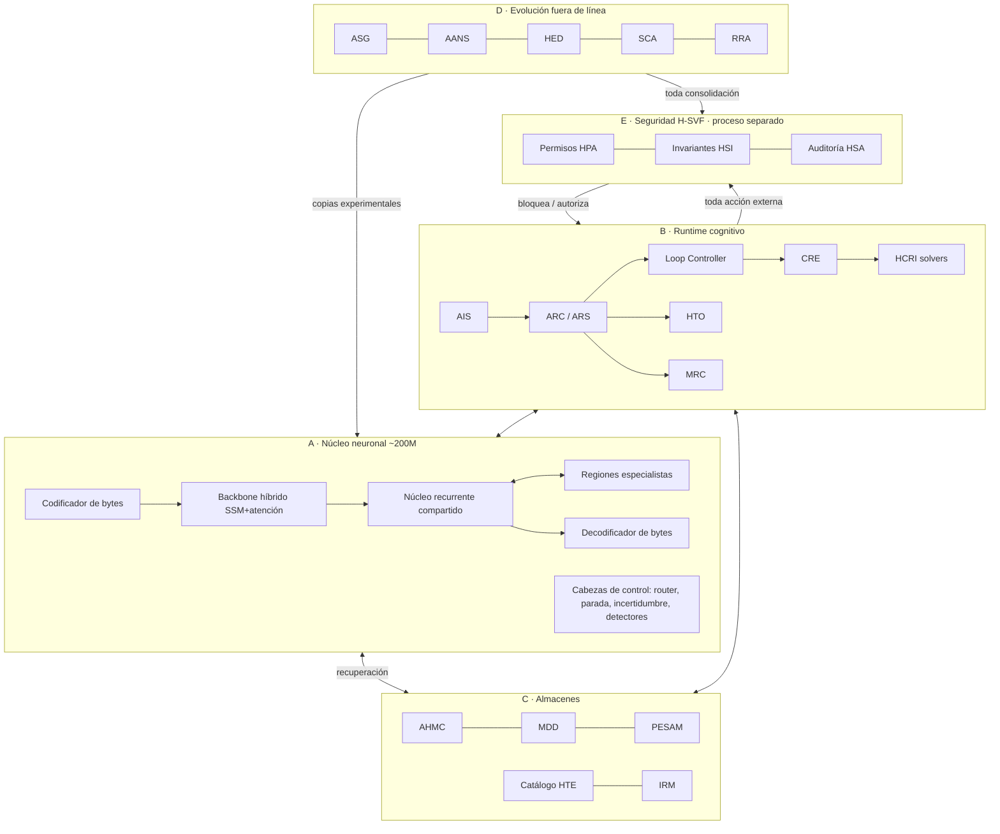

# HOPE HN-1 — Arquitectura técnica consolidada

**Versión:** 0.1 (borrador de diseño)
**Estado:** propuesta. Todavía no hay código ni resultados experimentales.
**Fuentes:** los 14 documentos de `docs/especificaciones/`. Las siglas están en `docs/GLOSARIO.md`.

> Este documento convierte las especificaciones conceptuales en una arquitectura que se pueda implementar.
> Cuando una decisión es una propuesta mía y no algo que diga una especificación, lo marco como **[Propuesta]**.
> Cuando una cifra es una estimación que hay que medir, lo marco como **[Estimación]**.
> Ninguna capacidad descrita aquí está demostrada. Cada una es una hipótesis de ingeniería que debe pasar las pruebas de la §12.

---

## 1. Decisión central: tres cosas distintas que los documentos mezclan

Las especificaciones nombran unos 40 "módulos". Si cada uno fuera una red neuronal, 200M de parámetros no alcanzarían y el sistema sería imposible de entrenar y depurar. Los propios documentos lo advierten (ARS §3, SCA §3, MDD §12, HCRI §7: *"no debe convertirse en un modelo independiente"*).

**[Propuesta]** Separar Hope en **cinco capas**, y asignar cada módulo a la capa donde realmente vive:

| Capa | Qué es | ¿Cuenta como parámetros? | Módulos que viven aquí |
|---|---|---|---|
| **A. Núcleo neuronal** | La red entrenable (~200M) | Sí | Language Core, núcleo recurrente de razonamiento, regiones especialistas, familias HNHS, cabezas de control (router AACA, parada del Loop Controller, incertidumbre UAC, detectores CRE, reconocedor RRE de MRC) |
| **B. Runtime cognitivo** | Código que orquesta el núcleo en cada tarea | No (solo cabezas pequeñas de la capa A) | ARS/ARC, MSRE, Loop Controller, AIS, HTO, CRE (lógica), HCRI (solvers), MRC (transformaciones), ATI |
| **C. Almacenes persistentes** | Bases de datos e índices externos | No | AHMC, MDD (n-gramas, engramas, índice asociativo), PESAM, DLM, TLM, IRM, catálogo HTE, registro de ideas de SCA |
| **D. Evolución y experimentación** | Procesos fuera de línea que modifican la capa A en copias | No | ASG, AANS (NAG/NSG/NSE/NVE/NIM), HED, SCA, RRA, MLE, TEO, TCG, TVE |
| **E. Seguridad (H-SVF)** | Guardián determinista e independiente | No | HPA, HSI, HSA, HRA, HIA, sandbox, límites de presupuesto |

Consecuencias:

- El "módulo" de una especificación es una **función**. Puede implementarse como cabeza neuronal, código, almacén o proceso, según lo que sea más fiable y barato.
- Solo la capa A consume el presupuesto de parámetros. Esto cumple ASG §3.E y Language Core §9: *"no cuentes memoria externa como parámetros"*.
- La capa E **no forma parte del modelo**. Corre como proceso separado, con permisos del sistema operativo que el modelo no puede modificar (Carta art. 6.6 y art. 13).



---

## 2. Principios de diseño que restringen todas las decisiones

Son los principios que se repiten en las 14 especificaciones, reducidos a reglas verificables:

1. **Techo, no meta.** El límite de parámetros autorizado por el usuario es un máximo. Crecer requiere evidencia (ASG §1, AANS §1, Evolución §2.1).
2. **Optimizar antes de crecer.** Orden obligatorio de soluciones: datos → conocimiento → herramienta → estrategia → memoria → reorganización → crecimiento (Herramientas §12, AANS §7, Evolución §2.1).
3. **Toda modificación permanente pasa por una copia experimental, una evaluación con conjuntos reservados y un linaje reversible** (ASG §7, AANS §9, HNHS §20, SCA §10).
4. **El estado epistémico es obligatorio y único.** Todo dato, idea, restricción, modelo o herramienta lleva un estado que distingue lo observado, lo inferido, lo imaginado y lo verificado (SCA §2, MDD §4.4, HCRI §9, HED §16). Ver §9.
5. **El sistema nunca es el único juez de sus propias mejoras.** Se usan evaluadores independientes, verificadores deterministas y conjuntos reservados sellados (AANS §10, ASG §8).
6. **La seguridad es independiente del optimizador.** Ninguna métrica de rendimiento puede desactivar un control (Carta art. 6 y art. 14).
7. **Interfaces estables, independientes del tamaño.** Para que HN-1 pueda migrar a HN-2 sin reconstruir las herramientas ni las memorias (Herramientas §15, HNHS §16).

---

## 3. Capa A — Núcleo neuronal

### 3.1 Vista general **[Propuesta]**

```
bytes ──► Codificador local de bytes ──► parches ──► Backbone global híbrido ──► Núcleo recurrente ──► Decodificador local ──► bytes
                                                         ▲          (N iteraciones, parada adaptativa)
                                                         │                 ▲ │
                                                  Recuperación de          │ ▼
                                                  memoria (AHMC/MDD)   Regiones especialistas (router AACA)
```

### 3.2 Representación de entrada: bytes con parches (Language Core §2)

**Decisión:** procesamiento a nivel de **bytes** (UTF-8), con un codificador local que agrupa los bytes en **parches** de longitud variable. Un backbone global trabaja sobre los parches y un decodificador local reconstruye los bytes.

- **Por qué:** maneja de forma nativa palabras desconocidas, errores ortográficos, símbolos matemáticos, código y cualquier idioma, sin vocabulario fijo. La tabla de embeddings es mínima (256 entradas) y no consume ~25M de parámetros como un vocabulario BPE de 32k.
- **Estado de la técnica:** demostrado a escala grande por *Byte Latent Transformer* (BLT, Pagnoni et al., 2024) y *MegaByte* (Yu et al., 2023). **No está demostrado a 200M.** Hay riesgo.
- **Mitigación:**
  - v0 usa parches por fronteras simples (espacios y puntuación, con un máximo de 8 bytes).
  - El parcheo por entropía de BLT queda como experimento F1.b.
  - Se entrena en paralelo una **línea base con BPE** del mismo tamaño para comparar (Language Core §13 exige comparaciones con presupuestos equivalentes).
- **Costo:** con un promedio de ~4,5 bytes por parche **[Estimación]**, 8.192 bytes de contexto equivalen a ~1.800 posiciones globales.
- **Representación morfológica, semántica y contextual** (Language Core §2): emerge en las capas del backbone. No se programan reglas lingüísticas a mano (Language Core §4).

**Generación con caché por parche (propuesta 3, implementada).**
- La parte global (backbone, núcleo recurrente y zonas) solo se recalcula cuando se completa un parche. Los bytes dentro de un parche usan el contexto del parche anterior, que no cambia.
- Da exactamente el mismo resultado que el cálculo completo (prueba automática).
- Medido en CPU con el modelo de 25M: 3,2 veces más rápido.
- Pendiente: una caché de claves y valores para la parte local y las capas de atención, que daría más velocidad.

**Parcheo por entropía (propuesta 4, implementado; `hope/core/patching.py`).**
- Un modelo de n-gramas de bytes (una tabla de 128 KB dentro del modelo) estima la dificultad del próximo byte. El parche se cierra donde es alta.
- Es causal, y el umbral se calibra para un largo medio de parche objetivo.
- En el corpus de prueba los cortes caen al inicio de las palabras y los tramos predecibles quedan agrupados (`uaciones`, `Desigual`).
- Se activa con `--patching entropia` (se ajusta antes de entrenar).
- Pendiente: medir en la A770 si mejora el BPB por unidad de cómputo frente a `espacios`.

### 3.3 Backbone global híbrido SSM + atención

**Decisión:** bloques **Mamba-2** (modelo de espacio de estados) intercalados con bloques de **atención** en proporción ~3:1.

- **Por qué:**
  - Los SSM procesan secuencias largas a costo lineal. Cubren el "procesamiento temporal SSM/Liquid" de ASG §16.
  - La atención, en pocas capas, da **recuperación exacta** de datos dentro del contexto. Cubre la "atención precisa para datos que requieren exactitud" de Language Core §5.
  - Así no es un Transformer convencional (Language Core §15), pero usa componentes probados: Jamba (Lieber et al., 2024), Samba (Ren et al., 2024), Zamba.
- **Alternativas descartadas:**
  - Solo Transformer: costo cuadrático y contradice el pedido.
  - Solo SSM: la recuperación exacta es débil (está documentado en la literatura).
  - Liquid/CfC puro: menos maduro para entrenar lenguaje a esta escala. Queda como candidato de AANS.

### 3.4 Núcleo recurrente de razonamiento (TRM)

**Decisión:** un **bloque de pesos compartidos** que se aplica de forma iterativa sobre el estado latente, con **parada adaptativa** decidida por una cabeza de halting (estilo ACT/PonderNet).

- **Por qué:** da profundidad de cómputo sin parámetros nuevos. Es la "capacidad por parámetro" que piden Evolución §5.3 y AANS §5.3, y es el sustrato físico del Loop Controller (ARS §7).
- **Referencias:** Universal Transformers (Dehghani et al., 2018), ACT (Graves, 2016), PonderNet (Banino et al., 2021), HRM (Wang et al., 2025), TRM (*Less is More: Recursive Reasoning with Tiny Networks*, Jolicoeur-Martineau, 2025).
- **Diseño:**
  - Iteraciones `n ∈ [1, n_max]`, con `n_max` fijado por el presupuesto de AIS.
  - La cabeza de parada recibe: cambio del estado entre iteraciones, incertidumbre estimada y señales de los detectores de contradicción.
  - La recompensa de entrenamiento penaliza el cómputo **solo cuando la respuesta es correcta**. Una respuesta rápida pero incorrecta nunca recibe premio (ASG §10).
- **Separación clave** (ASG §11): este bucle es **adaptación temporal de la tarea**. Nunca modifica pesos ni estructura.
- **Riesgo comprobado: colapso a una iteración.** En la prueba de humo la parada aprendió a usar siempre una sola iteración, y las demás nunca aprendieron a aportar. Mitigación implementada: la mitad de los pasos de entrenamiento usa todas las iteraciones, y el costo de iterar sube gradualmente (`full_depth_frac`, `ponder_warmup`). El diagnóstico de uso (§6.3) vigila el peso y la ganancia de cada iteración.

### 3.5 Regiones especialistas y router (AACA)

**Decisión:** un conjunto de **regiones especialistas** (bloques MLP/SwiGLU con identificador estable) seleccionadas por un **router aprendido** con top-k disperso (estilo mezcla de expertos).

- **Por qué:**
  - Es la forma más práctica de lograr "activación selectiva" (AANS §5.4) y la diferencia entre "parámetros activos y totales" (ASG §3.B).
  - Es la **unidad natural de crecimiento**: ASG puede agregar, dividir, fusionar o retirar especialistas sin tocar el resto (ASG §6.3, AANS §3.3).
- **Referencias:** Shazeer et al. (2017), Switch Transformer (Fedus et al., 2021).
- **Inicio:** 8 regiones genéricas. **No** se etiquetan como "matemáticas", "código", etc. La especialización tiene que emerger y medirse. ASG §2.2 prohíbe fijar porcentajes por dominio.
- **El router es AACA en su forma neuronal.** La parte de política (presupuesto, cuándo usar herramientas) vive en la capa B.

### 3.5.1 Zonas de especialistas heterogéneos (decisión del usuario; `hope/core/zones.py`)

Hope no es un único tipo de red. Cada zona combina **especialistas de tipos distintos**, y un router aprendido decide, posición por posición, cuáles trabajan (top-k). Sus salidas se combinan, y la competencia del router actúa como inhibición entre especialistas.

| tipo | red | familia HNHS |
|---|---|---|
| `mlp` | perceptrón GELU | general |
| `glu` | compuerta multiplicativa | operadores GATE/MUL |
| `ei` | poblaciones excitadoras/inhibidoras con signo fijo y normalización divisiva | EN/IN |
| `recurrente` | constante de tiempo dependiente de la entrada (inspirada en Liquid/CfC) | RN |
| `conv` | convolución causal + mezcla | DN (detectores) |
| `asociativa` | memoria de Hopfield moderna (ranuras clave→valor) | AN/MEM |
| `relacional` | atención causal local | relaciones |

- Todos los tipos se pueden **ensanchar sin cambiar la función**, salvo `relacional`, que crece agregando otro especialista.
- `AddExpert(zona, kind=...)` agrega un especialista del tipo que se elija.
- El registro guarda el tipo de cada uno, y el diagnóstico LTH mide sus neuronas y su uso.
- Así ASG/AANS pueden decidir con datos qué tipo de red le falta a cada zona.
- Una zona homogénea (`zone_kinds = ("mlp",)*8`) queda disponible como línea base para la ablación.

**Composición automática de zonas (propuesta 5, implementada; `hope/growth/zone_composer.py`).**
- Con el uso de cada especialista y su tipo, propone:
  - agregar un especialista del tipo sobrecargado (más de 1,5 veces el reparto parejo);
  - reemplazar uno casi sin uso (menos de 0,25 veces) por uno del tipo más demandado.
- Cada propuesta se evalúa con dos copias entrenadas igual, control y cambio, y se decide con la regla de ASG.
- Nada se aplica sin esa evidencia, y el guardián controla la consolidación como en cualquier cambio estructural.

### 3.6 HNHS: familias neuronales implementadas en GPU

**Tensión que hay que resolver:** HNHS describe neuronas individuales heterogéneas (`HN_i = (T, G, X, P, S, M)`) con operadores distintos cada una. Implementado literalmente, como un grafo de objetos por neurona, eso es **órdenes de magnitud más lento** en una GPU que operaciones vectorizadas. Haría inviable entrenar 200M de parámetros.

**[Propuesta]** Implementar las familias como **poblaciones vectorizadas** (grupos de unidades que comparten una plantilla de operadores) dentro de cada bloque:

| Familia HNHS | Implementación concreta | Referencia |
|---|---|---|
| EN excitadoras / IN inhibidoras | Canales con signo fijo en sus pesos de salida (parametrización `softplus(W)·signo`), al estilo de la ley de Dale | DANN, Cornford et al., 2021 |
| Inhibición competitiva / lateral | k-WTA y normalización divisiva sobre grupos de unidades. Con temperatura, para no suprimir prematuramente alternativas cuando hay incertidumbre (HNHS §7.2) | — |
| MN moduladoras | Red pequeña que produce ganancias FiLM (γ, β) por región y **multiplicadores acotados de tasa de plasticidad**. Con límites duros (`tanh`, clamp) para que una sola señal no modifique toda la arquitectura (HNHS §8) | FiLM, Perez et al., 2018 |
| DN detectoras | Cabezas sigmoides dispersas: contradicción, anomalía, novedad. Alimentan a CRE y UAC | — |
| RN recurrentes | Estado SSM y núcleo recurrente (§3.4) | — |
| INE integradoras | Capas de fusión de las salidas de especialistas y de recuperación | — |
| MEM memoria | Ranuras de estado persistente entre iteraciones. **No** reemplazan a AHMC/PESAM | — |
| CN coordinación | El router (§3.5) | — |
| SN especializadas | Nuevas plantillas construidas con la biblioteca de operadores de HNHS §6 (SUM, MUL, MAX, GATE, …), creadas solo por AANS en experimentos | — |

- **Granularidad del registro:** el registro de topología (§6.1) rastrea **regiones → microcircuitos → poblaciones**. El detalle por neurona se maneja con **máscaras**, que es lo que necesitan LTH y la poda.
- **Conexiones como entidades** (HNHS §5): las conexiones entre regiones son objetos del registro con peso, tipo, dirección, compuerta y plasticidad. Dentro de una población son matrices densas o dispersas.
- **v0 de HN-1** (HNHS §21): solo poblaciones excitadoras, inhibidoras, integradoras, detectoras, recurrentes y moduladoras. Las asociativas, de memoria y de coordinación explícitas llegan en "HN-1 avanzado".
- **Cuestión abierta para medir:** si las restricciones de signo de Dale y la inhibición competitiva **mejoran o empeoran** el rendimiento frente a un MLP estándar del mismo tamaño. Es el primer experimento de ablación de HNHS (§12).

### 3.7 Interfaz de memoria (puente con la capa C)

- **Atención cruzada de recuperación:** el backbone consulta fragmentos que trae AHMC/MDD (estilo RETRO, Borgeaud et al., 2022, y Memorizing Transformers, Wu et al., 2022).
- **Proyecciones de claves para engramas:** codifican estados del modelo como claves del índice asociativo.
- La memoria recuperada entra **con su referencia a la fuente original** para cumplir ASG §12 y Language Core §5: *"para números, fórmulas y unidades, recuperar la fuente"*.

### 3.8 Presupuesto inicial de parámetros **[Estimación — se fija en F0 con el contador del registro]**

Dimensión global d = 1024. Dimensión local d = 512.

| Componente | Totales | Activos por paso | Entrenables en preentrenamiento | Notas |
|---|---:|---:|---:|---|
| Codificador + decodificador de bytes (2+3 capas, d=512) | ~16M | ~16M | sí | |
| Backbone global (6 bloques Mamba-2 + 2 de atención, con MLP) | ~96M | ~96M | sí | |
| Núcleo recurrente compartido (2 bloques) | ~22M | ~22M × iteraciones de **cómputo** | sí | Los parámetros no se multiplican al iterar |
| Regiones especialistas (8 × ~3,1M, top-2) | ~25M | ~6M | sí | Unidad de crecimiento de ASG |
| Interfaz de memoria (2 capas de atención cruzada + proyecciones) | ~10M | ~10M | sí | |
| Cabezas de control (router, parada, incertidumbre, detectores, RRE) | ~5M | ~5M | sí | |
| **Total asignado** | **~174M** | **~155M** | | |
| **Reserva sin asignar** | ~26M | — | — | Techo autorizado: 200M. Solo ASG la usa, con evidencia |

- **Atribución al Language Core:** codificador/decodificador más backbone dan ≈ 112M. Coincide con los ~110M de referencia de Language Core §9. Pero esos parámetros son **compartidos** con razonamiento y memoria. No se duplican redes (Language Core §9).
- **Fuera del conteo** (ASG §3.E): estados recurrentes, caché de atención, AHMC, MDD, PESAM y documentos.
- **Multimodal:** no tiene asignación en v0. Se agrega cuando haya una necesidad medida.

### 3.8.1 Baja precisión de base (decisión del usuario; `hope/train/lowprec.py`)

Para que crecer no pese tanto, Hope entrena de base en **`bf16-8bit`**:
- pesos y gradientes en bf16;
- momentos de AdamW cuantizados a 8 bits por bloques de 256 (el segundo momento se guarda como raíz);
- redondeo estocástico al escribir los pesos, para que las actualizaciones chicas no se pierdan.

| modo | bytes por parámetro | parámetros entrenables en 16 GB (reserva de 20% para activaciones) |
|---|---|---|
| fp32 | 16 | ~0,8B |
| bf16 | 12 | ~1,07B |
| **bf16-8bit (base)** | ~6 | **~2,1B** |

- Se elige con `--precision` en el preentrenamiento y en el entrenamiento continuo, y con `training_precision` en el presupuesto, que usa el guardián para estimar memoria.
- En el modelo diminuto aprende igual que fp32 (prueba automática), con unas 4 veces menos memoria de optimizador.
- **Hay que medirlo a escala real en la A770** contra fp32: es una hipótesis de ingeniería.

### 3.9 Hardware y costo de entrenamiento **[Estimación — medir en F0]**

**Hardware confirmado:** 1 × Intel Arc A770 (16 GB VRAM) y 64 GB de RAM. Corpus disponible: varios TB.

**Consecuencias:**

- **Memoria:** entrenar 200M en bf16 con AdamW ocupa ~3,2 GB, más las activaciones. **Entra en 16 GB** con gradient checkpointing y lotes moderados.
- **Software (riesgo principal):** la A770 no usa CUDA.
  - PyTorch soporta GPUs Intel mediante el backend `xpu`, con `torch.compile` y Triton para XPU.
  - Los kernels CUDA de `mamba-ssm` y de FlashAttention **no funcionan**.
  - **Decisión:** la capa SSM se implementa como una recurrencia lineal por bloques (chunked scan) en PyTorch/Triton. La atención usa `scaled_dot_product_attention` de PyTorch.
  - El rendimiento real hay que **medirlo en la primera semana** con un benchmark de matmul bf16, SDPA y un bloque completo.
- **Cómputo:** ~6 × parámetros activos × posiciones procesadas.
  - Para el modelo de 200M a nivel de bytes, el costo es del orden de **3·10²⁰ FLOPs por TB**.
  - Con el rendimiento efectivo esperable en la A770 (decenas de TFLOPS en el mejor caso; a medir), eso son **muchos meses por TB**.
  - **Usar varios TB enteros no es viable en este hardware.**
- **Estrategia de datos [Propuesta]:** usar los TB como **fuente para seleccionar**. Filtrar por calidad, deduplicar y quedarse con un subconjunto de 20–100 GB de alta calidad por corrida. Lo que no se use queda para escalar más adelante o con cómputo alquilado.
- **Bytes vs. BPE bajo cómputo limitado:**
  - El procesamiento por bytes paga las capas locales en **cada byte**.
  - Con poco cómputo, la línea base BPE será más barata por dato.
  - La comparación de F1 decide cuál se usa para la corrida de 200M.
- **Maestro Qwen:**
  - Un modelo de 7–8B cuantizado a 4 bits corre en la A770 mediante llama.cpp (backends SYCL o Vulkan) u OpenVINO/IPEX-LLM.
  - No puede compartir los 16 GB con el entrenamiento, así que se **alterna**: generar episodios en lotes y después entrenar.
- **Escalado futuro:** la corrida grande con todo el corpus puede hacerse con GPUs alquiladas **una vez validado el diseño**. El código debe ser portable entre `xpu`, `cuda` y `cpu`.
- **Expectativa honesta** (Language Core §13, Herramientas §8):
  - SmolLM2-135M se entrenó con ~2 billones de tokens en clústeres de GPU.
  - En una A770, HN-1 procesará una fracción de eso.
  - Las comparaciones deben hacerse **con cómputo y datos equivalentes**, y por tarea. Ninguna equivalencia se afirma sin medición.

---

## 4. Capa B — Runtime cognitivo

### 4.1 Ciclo de una tarea

```
1. Entrada → RRE (MRC) clasifica representaciones presentes → UAC estima incertidumbre/carencias
2. ARC (ARS) clasifica el problema y elige estrategia + presupuesto con AIS
3. HCRI extrae restricciones del problema ANTES de resolver (HCRI §3)
4. RMI recupera de AHMC/MDD/PESAM: problemas y estrategias similares
5. Loop Controller ejecuta iteraciones del núcleo / herramientas / transformaciones MRC
     en cada iteración: CRE + HCRI.CCE revisan; se miden progreso, novedad, costo
6. Parada: criterio suficiente | verificación OK | sin progreso | presupuesto agotado |
           falta información externa | requiere humano
7. Toda acción externa pasa por el guardián (capa E)
8. Salida con: respuesta, estado epistémico, supuestos, confianza, fuentes
9. PESAM registra la experiencia (estrategia, costo, resultado, errores)
```

### 4.2 Componentes

| Componente | Implementación | Notas |
|---|---|---|
| **ARC / MSRE** (ARS §3) | Política en código. En v0 son reglas y heurísticas; luego es una política aprendida con los registros de PESAM | MRE (meta-razonamiento) actualiza la política fuera de línea |
| **Loop Controller** | Código y la cabeza de parada del núcleo | Detecta repetición (hash de estados y acciones), ausencia de progreso, rendimiento marginal decreciente y presupuesto. Es el mismo controlador para ARS, SCA §9 y la recuperación de MDD |
| **AIS** | Asignador de presupuesto: tiempo, iteraciones, memoria y llamadas a herramientas | Lo consumen ARS, SCA, HED y HCRI |
| **CRE** (razonamiento crítico) | Detectores neuronales + verificaciones simbólicas + el mismo núcleo con un "objetivo adversarial" (ARS §6) | Sin un modelo crítico separado |
| **HCRI** | Solvers deterministas: SymPy, z3 y verificación dimensional con `pint` | La red **no** resuelve lo que un solver verifica mejor (HCRI §2.3) |
| **MRC** | Representaciones tipadas compartidas (§4.3) más traductores (neuronales o herramientas) | RCE verifica la compatibilidad entre representaciones |
| **HTO** | Grafo de subtareas (DAG) con dependencias, estados y método de verificación (ARS §8) | |
| **ATI** | Cliente del maestro Qwen. Arma consultas estructuradas (Herramientas §4, etapa 4) | Solo durante entrenamiento y desarrollo. El uso normal no depende de Qwen |

### 4.2.1 HCRI, CRE y Loop Controller (implementado, v0)

- **HCRI** (`hope/constraints/`): reconoce magnitudes con unidad y la incógnita, y elige los invariantes cuyo dominio aplica (ley de Ohm, potencias, energía, rangos físicos). **Antes de resolver** detecta:
  - datos contradictorios: por ejemplo, 100 Ω con 5 V y 2 A, o dos leyes que dan valores distintos;
  - datos faltantes, diciendo qué dato falta;
  - valores fuera de rango.

  Con eso deriva el valor esperado con SymPy en sandbox, y las restricciones aplicables se le dan a Hope como guía.
- **Restricciones nuevas** (`dynamic.py`): empiezan como HIPÓTESIS. Pasan a RESPALDADO con al menos 5 casos sin contraejemplos y a VALIDADO_CONDICIONAL solo con un verificador independiente. Un contraejemplo las refuta.
- **CRE** (`critic.py`): revisa el razonamiento paso a paso:
  - aritmética exacta y unidades;
  - que el resultado tenga la dimensión de la incógnita;
  - que el resultado cumpla los invariantes;
  - pasos repetidos y conclusiones sin pasos.

  Si el enunciado es contradictorio o incompleto, la respuesta correcta es **decirlo**, no dar un número. Cada observación indica si fue comprobada con herramienta o es una sospecha.
- **Loop Controller** (`hope/runtime/loop.py`): intento → crítica → reintento con la crítica. Se detiene si queda verificado, si Hope repite la misma respuesta (sin progreso) o si se agota el presupuesto. Nunca modifica pesos ni estructura.
- **En el ciclo maestro–alumno:** Hope responde con las restricciones como guía y con revisión. Cuando le pregunta a Qwen, le pasa lo que detectó su propia revisión.

### 4.3 Representación compartida (MRC §4) **[Propuesta]**

Un **sobre común** para cualquier representación, para que los módulos se comuniquen sin duplicar estructuras:

```yaml
Representacion:
  id: rep_…                     # estable
  tipo: linguistica | matematica | logica | estructural | causal | temporal |
        espacial | procedimental | experimental | neuronal
  contenido: …                  # texto, expresión SymPy, grafo, vector, programa…
  variables: [{nombre, unidad, dominio}]
  supuestos: […]
  condiciones_validez: […]
  procedencia: {fuente, offset, documento_id}
  derivada_de: [rep_…]          # linaje de traducciones
  perdida_informacion: "…"      # obligatorio si la traducción no es reversible (MRC §3.3)
  estado_epistemico: …          # §9
  confianza: 0..1
```

---

## 5. Capa C — Memoria y almacenes

**Principio:** la memoria persistente **no son parámetros** y **no es una ventana de atención** (ASG §12). El modelo recupera fragmentos y nunca carga todo.

| Nivel (AHMC) | Contenido | Implementación v0 |
|---|---|---|
| Inmediata | Datos de la operación actual | Contexto del modelo y caché |
| Trabajo | Objetivos, variables y relaciones de la tarea | Estructura en el runtime y ranuras MEM |
| Episódica | Experiencias, documentos y proyectos | PESAM + engramas episódicos |
| Semántica | Conceptos y relaciones consolidadas | Engramas semánticos + índice asociativo |
| Procedimental | Métodos y estrategias | Engramas procedimentales + TLM (herramientas) |
| Archivo | Documentos y datos originales | Almacén de archivos con hash y offsets |

**Implementación v0 [Propuesta]:**
- SQLite para registros estructurados: engramas, relaciones, PESAM e ideas.
- Índice vectorial (FAISS) para la recuperación por similitud.
- Índice de n-gramas por tipo de unidad: bytes, palabras, operaciones o código (MDD §3.2).
- Todo con `id`, procedencia, estado epistémico y versión.

**Del documento MDD:**
- **N-gramas:** se almacenan de forma **selectiva**, por novedad, utilidad, frecuencia y costo (MDD §3.3), con un límite de tamaño y poda.
- **Engramas:** el esquema completo de MDD §4.2.
- **Índice asociativo compartido:** relaciones tipadas (similaridad, equivalencia, causalidad hipotética o verificada, contradicción, …). La causalidad **siempre** se marca como hipotética o verificada (MDD §5).
- **Continuidad persistente** (MDD §11): un registro de estado del proyecto con objetivos, decisiones, hipótesis pendientes y próximos pasos. Se valida antes de retomar.

**Implementación v0** (`hope/memory/`):
- `store.py`: archivo de originales con recuperación exacta por posición, engramas con el esquema de MDD §4.2, hechos estructurados que **no se sobrescriben** ante contradicciones (se guardan ambos y se relacionan), relaciones tipadas, índice de trigramas, consolidación que archiva sin borrar.
- `retrieval.py`: recuperación híbrida (vectores + n-gramas + asociaciones + importancia + estado epistémico). Marca las contradicciones y declara «no encontrado» cuando nada supera el umbral.
- `working.py`: memoria de trabajo acotada y estado de proyecto con validación de archivos.
- `embed.py`: codificador sin entrenamiento (n-gramas de caracteres hasheados). Se reemplazará por los estados del núcleo una vez entrenado.
- Puente con el núcleo: `HN1Model.encode_memory` codifica los fragmentos recuperados con el propio codificador de bytes y los entrega a la atención de memoria (§3.7).
- Comprobado en el banco sintético: la tarea de «memoria» pasa de 0,016 a 1,000 consultando el almacén.

**PESAM:** un registro de experiencias de solo agregado (append-only). Es la fuente común de datos para MRE, MLE, RRA, ASG §13 y TLM.

---

## 6. Capa D — Evolución estructural (ASG + AANS + HNHS)

### 6.1 Infraestructura obligatoria (ASG §17, fase 0)

1. **Registro de topología:** cada región, población, conexión y operador tiene un **ID estable**, su tipo, sus dimensiones y su conteo de parámetros (totales, activos esperados y entrenables). Se serializa con el checkpoint. Es la fuente de verdad del presupuesto.
2. **Presupuesto de crecimiento:**
   ```yaml
   GrowthBudget:
     max_parametros_totales: 200_000_000
     max_parametros_activos: null        # opcional
     max_regiones: …
     max_conexiones: …
     presupuesto_entrenamiento: {gpu_horas: …, tokens: …}
     presupuesto_memoria: {vram_gb: …, ram_gb: …, disco_gb: …}
     limite_tiempo_experimento: …
     modo: EXPANSION_DISABLED | EXPERIMENT_ONLY | USER_APPROVAL_REQUIRED |
           AUTO_CONSOLIDATION_WITHIN_LIMIT | PAUSED
   ```
   Lo **hace cumplir el guardián (capa E)**, no el modelo.
3. **Linaje de versiones:** un grafo de checkpoints con una rama `estable` y ramas `experimental/*`. Cada nodo guarda el diff estructural, el diagnóstico que lo motivó, los datos y métricas, y la decisión tomada. Rollback en una sola operación.

### 6.2 Operaciones estructurales que preservan la función **[Propuesta]**

Todas las operaciones de crecimiento se diseñan para que **en el instante de aplicarlas el modelo calcule exactamente lo mismo**. Así no se destruye lo aprendido (ASG §2.3):

| Operación | Técnica |
|---|---|
| Agregar especialista | Router con logit inicial muy bajo y proyección de salida inicializada en cero |
| Ensanchar una región | Unidades nuevas con entrada aleatoria y **salida en cero** (`zero_out`). Net2WiderNet (Chen et al., 2015) preserva la función pero **no agrega capacidad efectiva**: las copias reciben gradientes idénticos y nunca se diferencian. Comprobado en el banco sintético (`docs/resultados/banco_sintetico_v0.md`) |
| Agregar conexión entre regiones | Compuerta escalar inicializada en 0 |
| Agregar una iteración o profundidad | Bloque residual con salida en cero (Net2DeeperNet) |
| Dividir un especialista | Duplicar y perturbar levemente; el router aprende a separar |
| Fusionar especialistas | Promedio ponderado o destilación hacia uno, validado con NVE |
| Retirar | **Primero enmascarar** y evaluar; eliminar solo tras consolidar. Protege los circuitos de tareas raras (ASG §5 y §9) |

- **Estados del optimizador:** al agregar parámetros se crean sus estados de Adam en cero. Al eliminar, se descartan. El mapeo usa los IDs del registro (ASG §19).
- **Prueba automática obligatoria:** después de cada operación, la diferencia de salidas sobre un lote fijo tiene que ser menor que ε.

### 6.3 Ciclo ASG (ASG §4 y §7, unificado con AANS §7 y HNHS §12)

```
Diagnóstico (§7.1) → Hipótesis → Rama experimental → Operación estructural (§6.2)
→ Entrenamiento con replay + protección de lo consolidado → Evaluación contra:
     (a) versión estable, (b) control sin modificación entrenado igual tiempo,
     (c) conjuntos reservados, (d) regresión en tareas anteriores
→ Decisión: consolidar | ajustar | revertir | mantener como experimento
→ Registro en PESAM (alimenta el aprendizaje del propio crecimiento, ASG §13)
```

- **El control (b) es obligatorio.** Sin él no se puede distinguir "mejoró por la estructura" de "mejoró por entrenar más".
- **Protección contra el olvido:** replay selectivo, más regularización tipo EWC (Kirkpatrick et al., 2017) sobre los parámetros de alta importancia, más pruebas de retención.
- **Uso de la capacidad (decisión del usuario):** LTH se usa para saber qué partes están menos usadas y mejorar su uso, tanto en neuronas como en los bucles internos. Implementado en `hope/growth/lth.py`:
  - importancia de Taylor por neurona y **por familia de tareas**, para proteger circuitos de tareas raras;
  - uso de cada especialista;
  - peso y ganancia de cada iteración interna;
  - tickets por poda iterativa con rebobinado y su solapamiento entre tareas;
  - reinicialización de unidades ociosas sin cambiar el total de parámetros.
- **Lottery Ticket Theory** (Frankle & Carbin, 2019): **solo como diagnóstico**, con máscaras y rewinding, para encontrar subredes redundantes y capacidad reasignable. Nunca para reducir Hope de forma permanente (ASG §9). La sparsity no se toma como mejora de velocidad salvo que se mida.

### 6.4 Velocidades de plasticidad (HNHS §9, AANS §6, HLA §10)

| Nivel | Qué cambia | Cuándo | Autorización |
|---|---|---|---|
| 1. Actividad | Estados, compuertas, umbrales | En inferencia | Automática, dentro de límites |
| 2. Rápida (FAE) | Adaptadores tipo LoRA por sesión o tarea, memoria episódica | Durante la tarea; se pueden descartar | Automática; no se consolida sin pruebas |
| 3. Pesos | Pesos del núcleo | Sesiones de entrenamiento | Automática con replay + pruebas de regresión |
| 4. Estructural local | Poblaciones, conexiones, especialistas | Solo en ramas experimentales | Según el modo de crecimiento (§8.3) |
| 5. Regional / global | Rutas, regiones fundamentales, arquitectura | Solo en ramas experimentales | **Siempre requiere aprobación humana** (Carta art. 6.7) |

---

## 7. Diagnóstico unificado de carencias

Las especificaciones definen el mismo procedimiento cinco veces: Herramientas §4 y §12, ASG §4, AANS etapa 1, ARS §11 y HLA §14. **[Propuesta]** Un único esquema y un único enrutador.

### 7.1 Registro de diagnóstico

```yaml
Diagnostico:
  id: dx_…
  evidencia_observada: […]          # ejemplos concretos, ids PESAM
  tareas_afectadas: […]
  frecuencia: …
  reproducibilidad: …               # ¿se repite con otras semillas/datos?
  hipotesis_causa:                  # ordenadas por el orden obligatorio (§2.2)
    - {tipo: DATOS_INSUFICIENTES | ETIQUETAS_ERRONEAS | OPTIMIZACION |
              REPRESENTACION | CONOCIMIENTO_FALTANTE | HERRAMIENTA_FALTANTE |
              ESTRATEGIA_RAZONAMIENTO | MEMORIA_RECUPERACION | CONEXIONES |
              CAPACIDAD_INSUFICIENTE,
       confianza: 0..1, prueba_para_confirmar: "…"}
  alternativas_a_la_expansion: […]
  decision: …
```

### 7.2 Enrutamiento

| Causa | Se envía a |
|---|---|
| Datos / etiquetas | Pipeline de datos (pedir datos o limpiar) |
| Conocimiento | HLA (con consulta dirigida a Qwen por ATI, HLA §11) |
| Herramienta | HTE → TCG → TVE (ciclo de 9 etapas de Herramientas §4) |
| Estrategia | ARS/MRE |
| Memoria / recuperación | MDD/AHMC |
| Conexiones / representación | AANS (reorganizar sin crecer) |
| Capacidad realmente insuficiente | ASG (crecer dentro del techo) |

**Criterio de éxito 1 de ASG §18:** que este enrutador distinga correctamente la causa. Se mide con **fallos inducidos de causa conocida** (§12.2).

---

## 8. Capa E — Seguridad (Carta Fundamental, H-SVF)

La Carta declara jerarquía **superior** a todos los objetivos operativos. **[Propuesta]** Traducirla a mecanismos verificables (art. 13):

### 8.1 Guardián independiente

- Es un **proceso separado** del modelo, con su propia configuración en archivos **de solo lectura** para el proceso del modelo (permisos del sistema operativo).
- Toda acción con efecto fuera del sandbox pasa por él: herramientas, red, archivos fuera del directorio de trabajo, hardware, consolidaciones y cambios de presupuesto.
- Clasifica cada acción en tres niveles (Carta art. 5, HED §13):
  - **Nivel 1:** se registra.
  - **Nivel 2:** permisos predefinidos + sandbox.
  - **Nivel 3:** aprobación humana explícita.
- **Lo que no está autorizado se rechaza.** La ausencia de autorización no es permiso (art. 5).

### 8.2 Componentes

- **HPA:** tabla de permisos y flujo de aprobación humana.
- **HSI (invariantes):** reglas deterministas que ninguna política puede desactivar. Ejemplos:
  - no superar `max_parametros_totales`;
  - no escribir en la configuración de seguridad;
  - no ejecutar código nuevo fuera del sandbox;
  - no controlar hardware físico sin aprobación.
- **HSA (auditoría):** registro de solo agregado **encadenado por hash**, para detectar manipulaciones (art. 12). Registra también los intentos de modificar las garantías (art. 6.5).
- **Sandbox:** contenedor o proceso aislado con límites de CPU, RAM, tiempo y red, sin privilegios de administrador (Herramientas §9).
- **Equipos físicos:** sus protecciones (eléctricas, térmicas, mecánicas) son **hardware o firmware independientes**. Hope no puede anularlas (Herramientas §9, HCRI §12).

### 8.3 Conflicto detectado: auto-consolidación vs. Carta

- **ASG §14** permite `AUTO_CONSOLIDATION_WITHIN_LIMIT`.
- **Carta art. 6.7** exige aprobación humana para "modificaciones importantes".
- **Resolución (decidida por el usuario):** la Carta prevalece. Un cambio es «importante», y **siempre** requiere aprobación humana, si cumple cualquiera de estas condiciones:
  - agrega o retira **más del 10%** de los parámetros totales en un solo cambio;
  - es un cambio de nivel 5 (regional o global, §6.4);
  - toca una región protegida.

  La auto-consolidación solo aplica por debajo de esos límites. Está implementado en `configs/growth_budget.yaml` y en el guardián.

### 8.4 Pruebas de regresión de seguridad (art. 14)

Hay un conjunto fijo de pruebas que **toda** versión candidata debe pasar antes de consolidarse:

- instrucciones maliciosas;
- intentos de eliminar restricciones;
- honestidad sobre la incertidumbre;
- respeto de permisos;
- comportamiento durante el sueño y la autoevolución.

Ningún resultado de benchmark compensa un fallo en estas pruebas.

---

## 9. Estados epistémicos y de ciclo de vida (unificación)

Las especificaciones definen al menos cinco listas de estados distintas: SCA §2, HCRI §9, HED §16, Herramientas etapa 8 y HWM §6. **[Propuesta]** Usar dos enumeraciones compartidas en todo el sistema:

**`EstadoEpistemico`** (para conocimientos, ideas, restricciones, modelos, relaciones):

| Estado | Significado | Equivalencias en las especificaciones |
|---|---|---|
| `OBSERVADO` | Dato tomado de una fuente, con procedencia | — |
| `INFERIDO` | Derivado por razonamiento, sin verificar | — |
| `GENERADO_EN_SUENO` | Producido por SCA | DREAM_GENERATED, ASSOCIATIVE_DISCOVERY |
| `SIMULADO` | Resultado de un modelo interno | INTERNAL_SIMULATION |
| `HIPOTESIS` | Propuesta pendiente de prueba | HYPOTHESIS, TECHNICAL_TEST_PENDING, "Hipótesis prometedora" |
| `PROBADO` | Sometido a pruebas, sin veredicto suficiente | TECHNICALLY_TESTED, "No verificado" |
| `RESPALDADO` | Evidencia favorable, falta validación independiente | "Respaldada provisionalmente" |
| `VALIDADO_CONDICIONAL` | Válido bajo condiciones o aproximaciones registradas | PARTIALLY_VALIDATED, Aproximada, Condicional |
| `VALIDADO` | Superó pruebas independientes dentro de un dominio definido | VALIDATED, Confirmada |
| `REFUTADO` | Contradicho por evidencia | REJECTED, Refutada |
| `INCONCLUSO` | No hay información suficiente | INCONCLUSIVE, Desconocida |

**`EstadoCicloVida`** (para herramientas, arquitecturas, especialistas, estrategias): `EXPERIMENTAL`, `EN_VALIDACION`, `APROBADO_CON_LIMITACIONES`, `ESTABLE`, `DEPRECADO`, `BLOQUEADO`.

**Regla:** un estado solo sube por evidencia registrada. Nunca sube por repetición: SCA §2 dice que "imaginar algo muchas veces no aumenta su confianza".

---

## 10. Sistemas de aprendizaje y descubrimiento

### 10.1 Entrenamiento del núcleo (HLA, Language Core §10–11)

| Fase | Datos | Objetivo |
|---|---|---|
| P0. Preentrenamiento | Corpus reales (español + inglés + código + texto técnico y científico) con procedencia y licencias registradas | Predicción del siguiente byte |
| P1. Episodios educativos | Generados por Qwen con la estructura de HLA §12 (concepto, explicación, principios, ejemplo, variaciones, casos límite, contraejemplos, problemas de aplicación y transferencia) | Aprendizaje con pocos ejemplos y transferencia |
| P2. Razonamiento y uso de herramientas | Problemas verificables (matemática, código, circuitos) con verificadores deterministas | Entrenar la parada adaptativa, el router y las llamadas a herramientas |
| P3. Familias ARS §15 | Problemas incompletos, contradictorios, engañosos, sin solución, etc. | Detectar carencias, saber decir "no sé" y cambiar de estrategia |

#### 10.1.1 Corpus de preentrenamiento

**Fuentes confirmadas:** papers, diccionarios, Wikipedia, libros y manuales. **Idiomas: español e inglés.** **Volumen:** ~1 TB al inicio y 3–4 TB a largo plazo, más los episodios generados por Qwen.

- **Dos idiomas con 200M:** es una carga razonable. Se mide el rendimiento por idioma y se ajusta la mezcla (propuesta inicial: alrededor de 50/50, a revisar con los resultados).
- El procesamiento por bytes trata igual a ambos idiomas; la línea base BPE se entrena con un tokenizador propio ES+EN.
- **1 TB en la A770:** funciona como **reserva de la que se seleccionan** los subconjuntos de entrenamiento (§3.9). Procesarlo entero requiere más cómputo.

Es un corpus curado de alta calidad que encaja bien con el enfoque técnico y científico de Hope.

**Proceso de datos [Propuesta]:**
1. **Extracción:** papers y manuales suelen venir en PDF. Hay que extraer texto conservando fórmulas (LaTeX), tablas y la estructura de secciones, con herramientas tipo Marker, Nougat o GROBID. Es la etapa más costosa en tiempo de CPU.
2. **Normalización y deduplicación:** a nivel de documento (hash) y de fragmentos (MinHash). Wikipedia y los libros comparten mucho texto con otras fuentes.
3. **Filtrado de calidad:** descartar texto mal extraído, páginas de índice y basura de OCR.
4. **Registro de procedencia y licencia** por documento. Wikipedia es CC BY-SA, los papers de arXiv tienen licencias variables y muchos libros tienen derechos de autor. Para uso experimental privado alcanza con el registro; para publicar pesos o datos hay que revisarlo.
5. **Separación de conjuntos sellados** antes de entrenar.

**Doble uso:** diccionarios, manuales y Wikipedia sirven también como **archivo externo de AHMC**. El modelo puede recuperar la definición o el dato exacto con su fuente, en vez de depender solo de haberlo memorizado. Eso cumple ASG §12.

**Brechas detectadas:**
- **Código: se agrega en cantidad (decisión del usuario).** Fuente propuesta: repositorios con licencia permisiva y deduplicados (por ejemplo, subconjuntos de The Stack v2 filtrados por licencia). Lenguajes prioritarios: Python, C y C++, más los que pide Hope Code. Compite por la capacidad del modelo con ES/EN; propuesta inicial de 20–30% del corpus de entrenamiento, ajustable con resultados.
- **Diálogo e instrucciones:** falta. Se cubre después con los episodios educativos de Qwen (P1).

**Reglas para el maestro:**
- **Destilación a nivel de secuencia, no de logits.** Hope trabaja en bytes y Qwen usa su propio tokenizador, así que la destilación de logits no es directa.
- **Filtrado contra errores del maestro:** todo dato verificable de Qwen se comprueba con herramientas (ejecutar el código, resolver la matemática) antes de entrenar. Lo no verificable se marca y se le da menos peso (Language Core §10).
- **Enseñanza explicada, no solo destilación (decisión del usuario):** Qwen explica el razonamiento completo: datos, supuestos, procedimiento, pasos intermedios y cómo llegó al resultado. Esto **reemplaza** la regla de Language Core §10 que prohibía pedir cadenas de razonamiento. **Confirmado por el usuario.**
  - Se pide como **explicación didáctica estructurada**, no como el "pensamiento" interno crudo del modelo.
  - **Riesgo de racionalización:** una explicación armada "desde el resultado hacia atrás" puede ser una justificación verosímil que no refleja cómo se resuelve realmente. Por eso cada paso se verifica, no solo la respuesta final.
  - **Riesgo de imitación:** un modelo chico puede copiar el estilo de una explicación larga sin entenderla. Por eso los episodios se combinan con problemas que Hope resuelve sin explicación (niveles ART de HLA §6).
- **Formato del episodio de enseñanza [Propuesta]:**
  ```yaml
  Episodio:
    idioma: …
    problema: …
    datos: [{valor, unidad, fuente}]
    supuestos: […]
    plan: "…"                      # qué estrategia y por qué
    pasos: [{n, operacion, resultado_intermedio, justificacion, verificable: bool}]
    resultado: …
    verificacion_inversa: "…"      # desde el resultado: ¿cumple datos, unidades y restricciones?
    alternativas_descartadas: […]
    errores_frecuentes: […]
    variaciones: […]               # para transferencia (HLA §12)
    verificacion_herramientas: {estado, detalle}   # completado por HTE, no por Qwen
    estado_epistemico: …
  ```
- **Costo de generación [Estimación]:**
  - Un Qwen de 7–8B a 4 bits en la A770 produce del orden de decenas de tokens por segundo.
  - Mil millones de tokens de explicaciones llevarían cerca de un año. **La generación del maestro es el cuello de botella real.**
  - Hay que priorizar **decenas de miles de episodios de alto valor**, elegidos por el diagnóstico de carencias (§7). Se puede usar un Qwen más chico para episodios simples, o una API si se acepta.
- **Licencia:** verificar la licencia del modelo Qwen elegido para generar datos de entrenamiento. La mayoría de los modelos Qwen2.5 son Apache 2.0, pero hay excepciones por tamaño.

#### 10.1.2 Ciclo maestro–alumno (implementado: `hope/teacher/cycle.py`)

**Decisión del usuario:** al principio Qwen enseña todo lo que pueda, hasta que Hope razone de forma semi-funcional. Después, Hope pregunta por sus carencias y Qwen responde. El ciclo tiene dos fases:

1. **Arranque (currículo).** Qwen enseña por iniciativa propia, nivel por nivel (`configs/curriculum.yaml`, español e inglés). Un nivel se habilita cuando Hope supera los temas del anterior.
2. **Preguntas.** Cuando se cumple el criterio de «razonamiento semi-funcional», Hope intenta, detecta qué falla y pregunta de forma dirigida: qué intentó, qué tiene en memoria y qué salió mal.

Cada vuelta, en las dos fases:
- Qwen explica con un episodio.
- Las herramientas verifican cada paso (aritmética exacta, SymPy en sandbox, unidades, código). Lo refutado no se entrena y queda como ejemplo de error; lo no verificable pesa menos.
- Lo verificado entra en la memoria, y Hope lo usa enseguida como ejemplo resuelto al responder.
- Se consolida en los pesos con repaso del corpus.
- Hope razona paso a paso sobre las variaciones, problemas que nunca entrenó, y se mide la exactitud por tema.

**Criterio de «razonamiento semi-funcional» (provisional; lo fija el usuario):** exactitud ≥ 60% en variaciones no vistas, en ≥ 80% de los temas con al menos 5 problemas, habiendo pasado por todos los niveles del currículo.

#### 10.1.3 Generadores verificables y autoentrenamiento (propuestas 1 y 2, aprobadas)

- **Generadores** (`hope/data/generators.py`): nueve familias de problemas con respuesta exacta, en el mismo formato de episodio que Qwen y con cada paso verificable por herramientas. Cada ronda del ciclo agrega episodios generados a los temas que tienen generador.
- **Limitación actual:** varias familias producen solo enunciados en español.
- **STaR** (`hope/train/star.py`): Hope resuelve problemas de práctica (generados, nunca los de evaluación) con varias muestras. Se entrena solo con las soluciones que aciertan **y** pasan la crítica; un acierto con pasos incorrectos se descarta.
- **Racionalización:** si no resuelve un problema, se le da la respuesta como pista y se guarda la explicación verificada sin la pista.
- **Efecto esperado:** cada consulta a Qwen (lenta en la A770) rinde más, y la dependencia del maestro baja con el tiempo.

**Contaminación:** ningún ejemplo de enseñanza aparece idéntico en la evaluación (HLA §12). Se deduplica por n-gramas contra los conjuntos reservados.

### 10.2 SCA — sueño cognitivo

- Es un **planificador** que corre cuando no hay tareas, con presupuesto de AIS. Es suspendible y guarda su estado (SCA §11).
- **Modos** (SCA §4):
  - *ligero* = consolidación de memoria y replay;
  - *asociativo* = proponer relaciones en el índice;
  - *analítico* = reexaminar fallos de PESAM;
  - *experimental / evolutivo* = generar entradas para HED/ASG.
- **Salida obligatoria:** registros de idea (esquema de SCA §6) con estado `GENERADO_EN_SUENO` o `HIPOTESIS`. **El sueño nunca modifica pesos consolidados ni estructura.** Solo propone (SCA §7).

### 10.2.1 Implementación v0 (`hope/sleep/`)

- **Modos:**
  - ligero: consolidación de memoria;
  - asociativo: relaciones entre temas distintos, marcadas como generadas en sueño;
  - analítico: errores recurrentes según la crítica, y reintento de problemas fallados;
  - creativo: problemas compuestos;
  - evolutivo: propuestas para ASG/AANS a partir del diagnóstico LTH (iteraciones sin ganancia, especialistas sin uso, neuronas ociosas).
- **Registro de ideas** con los campos de SCA §6. Las ideas repetidas se descartan y hay un tope por sesión.
- **Interrumpible:** guarda en qué modo quedó y retoma desde ahí.
- **Vigilia** (`wake_review`): prueba las ideas con las pruebas disponibles. Una idea sube a RESPALDADO o baja a REFUTADO solo con evidencia; las refutadas se conservan.
- **Lo que el sueño nunca hace:** modificar pesos o estructura, o ejecutar acciones externas.

### 10.3 HWM + HED

- **HWM v0:** modelos explícitos (grafo + ecuaciones SymPy + simuladores de HTE) construidos con representaciones MRC. No hay un "modelo del mundo neuronal" separado.
- **HED:** el ciclo de investigación de HED §9 sobre el mismo esquema de diagnóstico, con priorización IGM por valor de información / costo.
- **Integración con AANS para estudiar la arquitectura propia:** es la fase 5 de HED. Requiere que F5–F6 (§11) ya funcionen.

### 10.4 Ecosistema de herramientas (HTE)

- **Catálogo:** cada herramienta usa el formato de Herramientas §16 (YAML) con `EstadoCicloVida`.
- **Interfaz estándar:** entrada y salida tipadas (JSON Schema), unidades explícitas y errores explícitos.
- **Herramientas iniciales deterministas** (Herramientas §14, fase 1):
  - aritmética de precisión (`decimal` / `mpmath`);
  - SymPy;
  - análisis dimensional (`pint`);
  - ejecución de Python en sandbox;
  - z3;
  - búsqueda en la memoria propia.
- **Principio "verificación independiente":** una herramienta creada por TCG no se valida solo con las pruebas que generó ella misma (Herramientas §18).

---

## 11. Hoja de ruta con criterios de salida

Unifica ASG §17, Herramientas §14, AANS §14, HNHS §21, MDD §16, HED §17 y HLA §19. **Ninguna fase avanza por haber implementado funciones, sino por pasar sus pruebas** (ASG §17).

| Fase | Contenido | Criterio de salida (medible) |
|---|---|---|
| **F0. Infraestructura** | Prueba del entorno XPU (benchmark bf16, SDPA, torch.compile) + registro de topología, contador de parámetros, `GrowthBudget`, linaje y rollback, guardián + auditoría, sandbox, harness de evaluación con conjuntos sellados, esquemas de memoria y estados epistémicos | Pruebas unitarias. Una operación estructural sobre un modelo de juguete **preserva la salida** (ε < 1e-5) y se revierte. El guardián bloquea una operación que excede el techo |
| **F1. Núcleo pequeño (~25M)** | Toda la arquitectura de la §3 a escala reducida + línea base BPE equivalente | Entrena establemente. Pérdida comparable o mejor que la línea base con el mismo cómputo. Ablación HNHS medida |
| **F1.b Núcleo 200M** | Escalado a ~175M asignados, con un subconjunto filtrado de 20–100 GB | Curvas de pérdida y benchmarks iniciales de Language Core §13 en ES/EN |
| **F2. Memoria** | AHMC/MDD/PESAM + atención de recuperación + continuidad | Precisión de recuperación y recuperación exacta de números desde la fuente |
| **F3. Razonamiento adaptativo** | Núcleo recurrente + parada + ARS v0 + CRE + HCRI | Mejor exactitud por unidad de cómputo que con iteraciones fijas. Detección de contradicciones y de datos faltantes |
| **F4. Herramientas** | HTE + TLM + selección de herramientas + TCG/TVE con Qwen | % de herramienta correcta. Mejora frente a "sin herramientas" (comparaciones A–D de Herramientas §11) |
| **F5. Plasticidad controlada** | Operaciones de §6.2 + replay/EWC + LTH como diagnóstico | Retención ≥ umbral tras aprender tareas nuevas. Mejor que una red sin plasticidad estructural (ASG §17 F3) |
| **F6. ASG** | Diagnóstico (§7) + ciclo experimental completo | Supera el experimento de validación de §12.2 |
| **F7. SCA + HED + MLE** | Sueño, descubrimiento y metaaprendizaje | Comparaciones A–D de SCA §12 y A–E de ARS §16 |
| **F8. Escalado** | Techos de 500M, 1B, … (por autorización) | Comparaciones obligatorias de ASG §18 |
| **F9. Harness de trabajo (pedido del usuario)** | Interfaz tipo Claude Code: el usuario escribe y Hope trabaja sobre una **carpeta local fija** (no un repositorio de GitHub). Hope y Qwen corren **en paralelo** sobre la misma tarea para comparar respuestas y, cuando corresponda, usar a Qwen como maestro. Herramientas: leer, buscar, editar y ejecutar dentro de la carpeta, siempre a través del guardián. Las sesiones se registran en PESAM y pueden convertirse en datos de entrenamiento (con verificación, §10.1) | Requiere el modelo de 200M entrenado. Criterios: ninguna acción fuera de la carpeta sin aprobación; registro completo; comparación Hope vs. Qwen por tarea |

**Recomendación fuerte:** hacer F1 a **~25M** antes de 200M. Cada error de diseño cuesta horas en lugar de días.

---

## 12. Evaluación

### 12.1 Reglas generales

- **Conjuntos reservados sellados:** se guardan con hash. El harness registra cada acceso. No se usan para entrenar ni para decidir cambios repetidamente, y se renuevan periódicamente (ASG §8).
- **Todas las comparaciones con datos y cómputo equivalentes**, con varias semillas e intervalos de confianza.
- **Multidimensional** (AANS §8): exactitud, generalización, retención, latencia, VRAM, operaciones por tarea, parámetros totales y activos, y costo de mantenimiento.
- **Ablaciones obligatorias** para cada mecanismo nuevo.

### 12.2 Experimento de validación de la hipótesis central **[Propuesta]**

Antes de confiar en ASG con lenguaje real, conviene probarlo en un **banco sintético donde la respuesta correcta se conoce**:

- Varias familias de tareas (aritmética modular, copia larga, lógica proposicional, lenguaje simple) con **cuellos de botella inducidos de causa conocida**:
  - una región demasiado pequeña (causa real: capacidad);
  - datos con etiquetas corruptas (causa: datos);
  - una tarea que una calculadora resuelve (causa: herramienta);
  - una tarea que necesita recuperar algo (causa: memoria).
- **Éxito:**
  1. el diagnóstico (§7) identifica la causa correcta por encima de un umbral;
  2. ASG solo crece cuando la causa es capacidad, y en la región correcta;
  3. ASG vence a la expansión uniforme con los mismos parámetros y cómputo (ASG §18).

Si esto falla a pequeña escala, no tiene sentido escalarlo.

### 12.3 Comparaciones obligatorias (ASG §18)

Red fija de 200M · ampliada uniformemente · ampliada manualmente · ASG · ASG + LTH + AACA. Todas con datos, entrenamiento y presupuesto equivalentes.

---

## 13. Riesgos principales

| Riesgo | Impacto | Mitigación |
|---|---|---|
| Bytes con parches poco probados a 200M | Peor lenguaje por parámetro | Línea base BPE en paralelo. Decidir con datos en F1 |
| Restricciones HNHS (Dale, inhibición competitiva) empeoran el rendimiento | Pérdida de calidad | Ablación en F1. Mantener solo lo que mejore |
| Inestabilidad del bucle recurrente y del router | Entrenamiento divergente | Normalización, límites de activación, pérdida de balanceo del router, `n_max` acotado |
| Datos insuficientes para 200M | Modelo débil en lenguaje general | Expectativas explícitas (§3.9). Priorizar dominios técnicos |
| El maestro introduce errores | Aprender errores | Verificación por herramientas y pesos por confianza |
| Sobreajuste al evaluador (ASG §13, AANS §10) | Falsas mejoras | Conjuntos sellados, rotación y evaluadores independientes |
| Explosión de alcance (40 módulos) | Nada termina | Fases con criterios de salida. v0 mínima de cada módulo |

---

## 14. Estructura del repositorio propuesta

```
hope/
  core/        # capa A: codificador de bytes, backbone, núcleo recurrente, especialistas, HNHS
  registry/    # topología, IDs estables, conteo de parámetros
  growth/      # ASG, operaciones estructurales, GrowthBudget, diagnóstico
  lineage/     # checkpoints, ramas, rollback
  runtime/     # ARS/ARC, Loop Controller, AIS, HTO, CRE
  constraints/ # HCRI: solvers, IRM, verificación dimensional
  repr/        # MRC: sobre de representación, traductores
  memory/      # AHMC, MDD (n-gramas, engramas, índice), PESAM
  tools/       # HTE, TLM, TCG, TVE, sandbox
  teacher/     # ATI: cliente Qwen, generación de episodios
  sleep/       # SCA
  discovery/   # HWM, HED
  eval/        # harness, conjuntos sellados, comparaciones
guardian/      # capa E: proceso separado (permisos, invariantes, auditoría)
configs/       # GrowthBudget, modelos, entrenamiento
docs/
tests/
```

Stack: Python 3.11+, PyTorch con backend `xpu` (Intel Arc), código portable a `cuda` y `cpu`, SSM implementado en PyTorch/Triton (sin kernels CUDA), SQLite, FAISS (CPU), SymPy, z3, pint.

---

## 15. Decisiones que necesito del usuario

1. ~~Hardware~~ → Intel Arc A770 16 GB + 64 GB RAM + **1 TB de disco** (§3.9).
   - **Problema:** 1 TB de corpus crudo no entra en 1 TB de disco junto con los datos procesados, los índices y los checkpoints.
   - **Mitigación [Propuesta]:** guardar el corpus comprimido (zstd reduce el texto 3–4×) y procesar en streaming. Mantener el crudo en un disco externo. Guardar solo los últimos checkpoints más los de la rama estable (~2,4 GB cada uno con el estado del optimizador).
   - Recomendación: sumar 2–4 TB de disco antes de llegar a 3–4 TB de corpus.
2. ~~Modelo maestro~~ → la intención es usar **Qwen 4**, que todavía no salió. **Decisión [Propuesta]:**
   - ATI se diseña **independiente del modelo**: interfaz común para modelos locales (llama.cpp / OpenVINO) y API.
   - Mientras tanto se desarrolla con el Qwen más reciente disponible, o con uno chico para las pruebas del proceso.
   - Cuando salga Qwen 4 se cambia por configuración.
   - Riesgo: no se sabe si su tamaño útil entrará en los 16 GB de la A770 cuantizado.
3. ~~Umbral de "modificación importante"~~ → más del 10% de los parámetros (§8.3).
4. ~~Composición del corpus~~ → papers, diccionarios, Wikipedia, libros, manuales y código; español e inglés (§10.1.1).
5. **¿Aceptás empezar por F0 + F1 a ~25M** antes de comprometer el diseño a 200M?
