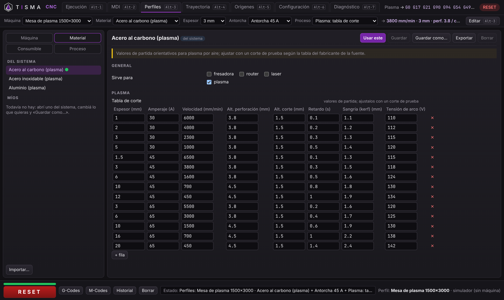

# TISMA CNC (Hope CNC): control CNC moderno como herramienta interna de Hope

**Objetivo:** reemplazar Mach3 con un programa que funcione igual en una PC vieja y en una
moderna, que **revise el programa antes de mover la máquina** y en el que Hope pueda ayudar
(revisar, simular, explicar errores) pero **nunca mover la máquina sin permiso humano**.

Código: `hope/cnc/`. Pruebas: `tests/test_cnc.py`. Máquina de ejemplo: `configs/cnc_maquina.yaml`.

## 1. Por qué Mach3 envejeció y qué se cambia

| Mach3 | Hope CNC |
|---|---|
| Genera los pulsos desde Windows por el puerto paralelo: depende de la latencia de la PC y de un driver de 32 bits | La PC **no genera pulsos**. Los genera un controlador de tiempo real (grblHAL, FluidNC, LinuxCNC con Mesa o con puerto paralelo) |
| Lo que se revisa no es exactamente lo que se ejecuta (macros, modos de Mach3) | Un **solo intérprete** (el de Hope) decide la trayectoria; al controlador le llega G-code normalizado y simple |
| Los errores aparecen con la máquina en marcha | **Revisión previa**: límites de recorrido (arcos incluidos), husillo, F faltante, códigos no soportados, tiempo real con aceleración |
| Solo Windows | Python en Windows, Linux o Raspberry Pi; el controlador puede ser USB o Ethernet |

## 2. Arquitectura

```
 G-code (CAM, Mach3)        configs/cnc_maquina.yaml
        │                            │
        ▼                            ▼
  gcode.py: intérprete ──► Program (ops en coordenadas de máquina, diagnósticos por línea)
        │
        ├─► planner.py: lookahead + trapecios ──► tiempo exacto, velocidades por tramo
        ├─► check.py:   límites, husillo, final ──► informe («LISTO» / «NO se puede enviar»)
        └─► dialect.py: G-code normalizado (grbl | linuxcnc)
                    │
        controller.py ── guardián: hardware.control (aprobación humana, ligada al hash)
                    │
        backends/: sim │ grbl (serie/TCP, conteo de caracteres) │ linuxcnc (API Python)
                    │
          tiempo real: grblHAL / FluidNC / LinuxCNC ──► drivers ──► motores
```

La **seta de emergencia** corta físicamente la potencia de los drivers. Ningún software, tampoco
este, la reemplaza.

## 3. Equipos viejos y modernos

| Equipo | Camino recomendado | Configuración (`controlador:`) |
|---|---|---|
| PC vieja con **puerto paralelo** y la placa de conexión de Mach3 | LinuxCNC (ISO de linuxcnc.org, StepConf); mismos cables | `tipo: linuxcnc` |
| PC vieja **sin** buen tiempo real, o laptop | grblHAL/FluidNC por USB: la PC solo envía líneas, así que sirve casi cualquier equipo | `tipo: grbl`, `puerto: /dev/ttyUSB0` o `COM3` |
| PC moderna o mini PC | grblHAL por Ethernet (Teensy 4.1, placas BTT/PicoCNC), o LinuxCNC con Mesa 7i96S/7i76E | `tipo: grbl`, `puerto: tcp://IP:23`, `bufer: 1024` |
| Raspberry Pi 4/5 | LinuxCNC (imagen para Pi) o grblHAL por USB | igual que arriba |
| Router con placa de impresora 3D (MPCNC, Lowrider…) | Marlin, Smoothieware o RepRapFirmware por USB | `tipo: ok`, `puerto: COM3` |
| Sin hardware | Simulador | `tipo: sim` |

Para pasar los datos de Mach3: en *Config → Motor Tuning*, «Steps per» → `pasos_mm`,
«Velocity» → `vel_max` (mm/min) y «Acceleration» → `acel` (mm/s²). Los límites de *Homing/Limits*
van en `min`/`max`.

## 4. Qué hay en la v0

* **Intérprete** (`gcode.py`): G0/G1/G2/G3 (IJK, R, vueltas con P, helicoidales), G4, G17–G19,
  G20/G21, G90/G91, G90.1/G91.1, G28/G30, G53, G54–G59, G10 L2/L20, G92/G92.1, G43 Hn con tabla de
  herramientas, G43.1, G49, G61/G64, G98/G99 y los ciclos de taladrado G81/G82/G83/G73 (expandidos,
  así funcionan también en grbl). M0/M1, M2/M30, M3/M4/M5, M6, M7/M8/M9, comentarios, `(MSG, …)` y
  borrado de bloque.
  Los códigos propios de Mach3 también se entienden, con la definición del manual de Mach3Mill
  (§10.7):
  * **G12/G13**: cajera circular;
  * **G15/G16**: coordenadas polares para G0, G1 y ciclos;
  * **G52**: origen temporal;
  * **M98 P… L… / O… / M99**: subprogramas en el mismo archivo, con repeticiones;
  * **G31**: sensado.

  G50/G51 (escala) dan un **error claro**. Las macros de usuario (M100 en adelante) dan un aviso.
* **Planificador** (`planner.py`): el mismo modelo que grbl (desviación de unión, pasada hacia
  atrás y hacia adelante, trapecios), con tiempos exactos. Comprobado contra cálculos a mano.
* **Revisión** (`check.py`): envolvente en máquina y G54, límites de recorrido por línea, corte
  con husillo apagado, programa sin M2/M30, tiempo, distancias y herramientas.
* **Traducción** (`dialect.py`): G-code normalizado por dialecto. Al volver a interpretar la
  traducción salen **los mismos movimientos y el mismo tiempo** (hay una prueba de ida y vuelta).
* **Controladores**:
  * `sim`;
  * `grbl` (serie o TCP, conteo de caracteres, estados, `$#`, errores y alarmas explicados, `!`/`~`/reinicio);
  * `linuxcnc` (modo automático por la API).
* **Guardián**: ejecutar en una máquina real es `hardware.control` (nivel humano). La aprobación
  queda ligada a:
  * el hash del programa;
  * la máquina y el controlador;
  * la envolvente calculada con los **orígenes reales** leídos del controlador.

  Cada aprobación se usa una vez. Un programa con errores nunca llega al controlador.
* **Pausas**: M0 y el cambio manual de herramienta en grbl esperan al operador (Enter para
  seguir, «a» para abortar con reinicio).
* **Herramienta interna de Hope**: `⟦cnc: pieza.nc | maquina=… dialecto=grbl⟧` revisa en el
  sandbox y **no mueve nada** (`hte_cnc_v1`).

### Uso

```bash
python -m hope.cnc revisar pieza.nc --maquina configs/cnc_maquina.yaml
python -m hope.cnc traducir pieza.nc --dialecto grbl --salida pieza_grbl.nc
python -m hope.cnc estado
python -m hope.cnc enviar pieza.nc                       # crea la solicitud en el guardián
python -m guardian.cli approve <id> --by <tu-nombre>
python -m hope.cnc enviar pieza.nc --aprobacion <id>
```

Para grbl por puerto serie hace falta `pip install pyserial`. Por TCP no hace falta nada más.

## 5. Límites honestos de la v0

* **Sin probar en una máquina real.** El protocolo de grbl está probado contra un grbl simulado y
  LinuxCNC solo en el caso «no instalado». Primera prueba real: en el aire, con Z arriba y sin
  herramienta.
* Sin parámetros ni expresiones (`#1`, `[ ]`), compensación de radio G41/G42, tiempo inverso G93
  ni escala G50/G51.
* Ciclos fijos solo en G17 y G90.
* El sensado (G38.2/G31) solo se usa para la altura en Z (plasma); la medición de largo de
  herramienta todavía no tiene asistente.
* El tiempo usa el modelo trapezoidal de grbl. Con curva S (grblHAL, LinuxCNC 2.9 o posterior) la
  máquina real puede tardar un poco más.

## 6. App de PC (pantalla estilo Mach3)


Doble clic en **`TISMA CNC.bat`** (Windows) o `./tisma_cnc.sh` (Linux), o `python -m hope.cnc app`.
Abre una ventana propia (Edge/Chrome/Chromium en modo app; si no hay, el navegador). Solo necesita
Python 3.10+, `pyyaml` y, para grbl por USB, `pyserial`: nada de PyTorch ni placa de video, así que
corre igual en una PC vieja. La vista 3D usa canvas 2D (sin WebGL) y el listado de G-code es virtual
(rinde con cientos de miles de líneas). Sin `controlador:` configurado arranca con el **simulador**,
que ejecuta el programa en tiempo real con aceleración, pausas y overrides.

**Misma distribución que Mach3.** Se tomó de las capturas oficiales de Mach3Mill (manual «Using
Mach3Mill» 1.84, Apéndice 1, y descripción de cada control en el capítulo 6), con aspecto actual y
la paleta TISMA:

| Mach3Mill (1024.set) | TISMA CNC |
|---|---|
| Pantallas Program Run Alt-1, MDI Alt-2, ToolPath Alt-4, Offsets Alt-5, Settings Alt-6, Diagnostics Alt-7 | Ejecución, MDI, Trayectoria, Orígenes, Configuración, Diagnóstico con **los mismos atajos** |
| Línea de G-codes activos arriba a la derecha («Mill->G15 G80 G17…») | Igual (estado modal del controlador o del simulador) |
| Program Run: G-code arriba a la izquierda con «File:» debajo; DRO al centro con «REF ALL HOME» vertical, «Zero X/Y/Z» y LED de referenciado por eje; Toolpath arriba a la derecha con Regen. Toolpath, Display Mode y Jog Follow | Igual: Regenerar, Vista (Arriba/ISO/Frente/Lado) y Seguir; debajo del DRO, Ir a cero (GOTO Z), Coord. máquina con LED, Cero todo y Límites soft |
| Abajo: Cycle Start Alt-R, Feed Hold Espacio, Stop Alt-S; Edit G-Code, Recent File, Close G-Code, Load G-Code, Set Next Line, Line, Run From Here; Rewind Ctrl-W, Single BLK Alt-N, Block Delete, M1 Optional Stop, Flood Ctrl-F; LEDs Dwell y CV Mode | Igual, todos funcionando (Editar G-code con editor propio, Archivos recientes guardados, Run From Here sube Z, va al punto, recupera husillo/refrigerante y baja; en plasma vuelve a la perforación del corte) |
| Tool Information (Tool, Change, Dia., H, Elapsed, Jog ON/OFF Ctrl-Alt-J), Feed Rate (FRO ▲▼ Reset, F, Units/Min), Spindle Speed (Spindle CW F5, RPM, S, SRO ▲▼ Reset) | Igual; en plasma, Spindle Speed se reemplaza por **Antorcha** |
| RESET con LED que parpadea rojo/verde abajo a la izquierda en todas las pantallas; History, Clear, Status:, Profile: | Igual |
| MDI: DRO, Stop (Esc), Feed y Spindle, Toolpath y la línea «Input» abajo con historial (↑/↓); Enter la selecciona | Igual, con atajos G90/G91/G21/G20/G54… |
| Offsets: Gage Block Height + Set Z, Current Work Offset, Fixture 1–6 (G54–G59), tabla de herramientas | Igual: Fijar Z (G10 L20), editar el origen (G10 L2), elegir el origen activo, tabla de herramientas |
| Jog flyout con Tab: Jog Mode (Cont./Step), Cycle Jog Step, Slow Jog Rate ±5 %, Button Jog; flechas, RePág/AvPág, Mayús = rápido | Igual |

Diferencias a propósito: **Esc es Stop** (como en la pantalla MDI de Mach3). Reverse Run, Teach,
Wizards y MPG por puerto paralelo no están; el escalado G51 tampoco (se rechaza con un mensaje).

**Seguridad en la app:** el servidor escucha solo en 127.0.0.1 y rechaza un `Host` que no sea local.
Las acciones son POST con encabezado propio y JSON, así que otra página web no puede mandarlas.
Con una máquina real hacen falta dos aprobaciones, y las dos quedan en la auditoría del guardián:

* habilitar el modo manual, al salir de RESET;
* cada Cycle Start, ligada al hash del programa y a la envolvente calculada con los orígenes
  reales.

Probado: ver `tests/test_cnc_app.py`.

* Sesión con el simulador: progreso, pausa M0, overrides, jog continuo hasta el límite, ceros y
  referenciado.
* Conexión en vivo con un grbl falso con hilos: conteo de caracteres, estado, `$#`, `$J`, overrides
  y errores.
* Flujo de aprobaciones.
* Servidor y su seguridad.

En la app, LinuxCNC todavía se maneja con `python -m hope.cnc enviar` (la ventana en vivo cubre el
simulador y grbl/grblHAL/FluidNC).

## 7. Plasma


Con `tipo: plasma` (ejemplo completo en `configs/cnc_plasma.yaml`), M3 enciende la antorcha y M5 la
apaga. Z0 de trabajo es la superficie de la chapa.

* **Perforación automática** (`perforacion_auto: true`), para programas que no la traen. En cada M3
  se arma la secuencia:
  1. sensado de altura (IHS), si está activo;
  2. altura de perforación;
  3. antorcha encendida;
  4. retardo;
  5. bajada a la altura de corte.

  En cada M5 sube a la altura de traslado. Si el CAM ya genera la secuencia (SheetCam y otros),
  se deja en `false`.
* **Sensado de altura con cabezal flotante:** `G38.2`, y también el **`G31` de Mach3**, que es lo
  que sacan los postprocesadores de Mach3 para plasma. Después, `G10 L20 P1 Z-holgura` pone Z0 en
  la chapa *medida*.
  * La traducción envía el `G10 L20` al controlador, y las alturas siguientes quedan relativas a la
    chapa real, no fijas.
  * Para planificar y simular se supone el contacto donde se espera la chapa.
  * Para revisar los límites se usa el recorrido completo del sensado, que es el peor caso.
* **Revisiones propias de plasma:**
  * cantidad de perforaciones, que es lo que gasta los consumibles;
  * metros de corte con la antorcha encendida;
  * rápidos con la antorcha encendida;
  * perforaciones sin retardo antes de moverse;
  * cortes con la antorcha apagada.
* **Panel «Antorcha» en la app**, en lugar del de husillo:
  * estado ENCENDIDA o APAGADA;
  * perforaciones hechas sobre el total;
  * alturas y retardo configurados;
  * **Sensar altura**;
  * **Disparo de prueba** (0,3 s, con confirmación).

  En la trayectoria, las perforaciones se marcan en naranja y los avances sin cortar en gris.
* **No incluido:** el control de altura en marcha por tensión de arco (THC). Lo tiene que hacer el
  controlador, porque necesita tiempo real: grblHAL tiene complemento de plasma y LinuxCNC tiene
  QtPlasmaC. Tampoco hay compensación de sangría (kerf); la hace el CAM.

## 8. Marca y colores (tema TISMA)

La app se llama **TISMA CNC** (`BRAND` en `hope/cnc/session.py`). Lleva el logo de TISMA (hexágono
con la pirámide violeta) y el logotipo «TISMA» con la I en violeta; el logo también es el ícono de
la ventana (`logo.svg`). Los colores están en `hope/cnc/app/static/tema_tisma.css` y salen de los
píxeles del logo:

| Color | Valor | Dónde |
|---|---|---|
| Violeta TISMA | `#9437c1` → `#7525a7` → `#521386` | marca, pestañas, línea actual, progreso, corte pendiente, selecciones |
| Gris TISMA | `#cecece` | logo, posición de máquina, lo ya cortado |
| Negro TISMA | `#1b1b1b` | base del fondo oscuro |

El fondo es oscuro para que no encandile en el taller. Los colores de seguridad no cambian a
propósito: Cycle Start verde, Feed Hold ámbar, Stop y RESET rojos, y antorcha y perforaciones en
naranja.

## 9. Perfiles tipo slicer



Como en un slicer de impresión 3D (PrusaSlicer, OrcaSlicer, TISMA Engine), se eligen cuatro perfiles
en la barra de arriba y la app calcula el resto:

| Perfil | Equivale en un slicer a | Qué guarda |
|---|---|---|
| **Máquina** | impresora | tipo (fresadora, router, láser, plasma), ejes, recorridos, velocidades, aceleraciones, orígenes, herramientas, controlador, sensado de altura |
| **Material** | filamento | plasma: **tabla de corte** por espesor y amperaje (velocidad, alturas de perforación y corte, retardo, kerf, tensión); fresado: **velocidad de corte** (o RPM fijas), **carga de viruta** por diámetro de fresa, % de bajada y pasada recomendada |
| **Consumible / herramienta** | boquilla | amperaje de la antorcha; diámetro, filos y forma de la fresa |
| **Proceso** | perfil de impresión | avance del perfil, limitar al perfil o el del programa (como Mach3); %; perforación automática; sensado; altura de traslado; retardo extra; poner la S que falte; ancho de pasada (adelgazamiento de viruta) |

En plasma se elige además el **espesor**. El resultado se ve al lado, por ejemplo
`3800 mm/min · 3 mm · perf. 3.8 / corte 1.5 mm · 0.30 s · kerf 1.5`, y se aplica al G-code:

* el avance de corte, solo con la antorcha o el husillo encendidos y con movimiento en XY;
* las bajadas en Z;
* la secuencia de perforación;
* la S que falte.

El informe del programa dice qué perfil se usó.

**Calculadora de avances y velocidades (fresado y router)**, como las de FSWizard, cncfeeds.com o
la del Fablab del MIT, pero integrada en los perfiles:

* **RPM** desde la **velocidad de corte** del material: RPM = Vc × 1000 / (π × D), con Vc en m/min
  (es la fórmula métrica `SMM × 318 / D`; en pulgadas, `SFM × 3,82 / D`, y SFM × 0,3048 = m/min).
  Se recorta al rango del husillo de la máquina. Sin Vc se usan las RPM fijas del material.
* **Avance** = RPM × filos × **carga de viruta** (tabla del material por diámetro de fresa).
* **Adelgazamiento de viruta:** si el proceso indica un ancho de pasada menor que medio diámetro
  (desbaste adaptativo del CAM), el avance sube por D / (2·√(D·ae − ae²)), hasta 3 veces. Viene el
  proceso «Fresado: desbaste adaptativo (pasada 15 %)».
* **Que no roce:** si la máquina no llega al avance calculado, en lugar de dejar la fresa rozando
  (calor, madera quemada, filo gastado) se **bajan las RPM** para mantener la carga de viruta, y se
  avisa; si el husillo no baja tanto, avisa que va a rozar.
* **Pasada recomendada** para el CAM (lateral y profundidad, en mm para la fresa elegida) y el
  volumen de material que se saca por minuto.

Son valores de partida para fresas de metal duro (con acero rápido, HSS, la velocidad de corte es
cerca de un tercio): ajustar según la rigidez de la máquina, la potencia del husillo y cómo suena.

* **Formato:** un archivo JSON por perfil con `"hereda"`. Los perfiles del sistema están en
  `hope/cnc/perfiles/` y son de solo lectura. Los tuyos van en `runs/cnc/perfiles/` y guardan
  **solo lo que cambia** respecto del padre: «Guardar como…» desde un perfil del sistema crea uno
  propio que lo hereda.
* **Editor** (pestaña Perfiles, **Alt-3**, que Mach3 deja libre):
  * campos por grupo;
  * los heredados atenuados, los propios resaltados con ↺ para volver al valor del padre;
  * tablas editables;
  * Exportar e Importar, para pasar perfiles entre PCs con un pendrive (los nombres de archivo son
    solo ASCII).
* **Valores incluidos:** son **orientativos de partida**:
  * plasma por aire: acero al carbono, inoxidable y aluminio, a 30, 45 y 65 A;
  * fresado: MDF, madera dura, contrachapado, acrílico y aluminio.

  Ajustalos con un corte de prueba y la tabla del fabricante de tu fuente o tus fresas.
* **Configuraciones YAML de antes:** `python -m hope.cnc app --maquina mi_maquina.yaml` las importa
  como perfil de máquina.

## 10. Compatibilidad máxima

**Equipos viejos («cuanto más viejo, mejor»):**

* **Python 3.7** como mínimo para el código fuente (Windows Vista). Las pruebas de CNC pasan en
  3.7, 3.8 y 3.13, y `hope/cnc/ruff.toml` evita que se cuele sintaxis más nueva.
* **Python 3.4 (Windows XP)** con la edición XP: al armarla, el código se traduce solo (§11). Toda
  la suite de pruebas traducida pasa en un Python 3.4 real.
* **Solo la biblioteca estándar de Python** para el núcleo, la app y los perfiles (JSON). Aparte
  hacen falta `pyserial`, para controladores por USB, y `pyyaml`, para el guardián y las
  configuraciones YAML viejas. Nada de PyTorch, NumPy ni placa de video.
* **Navegador:** desde **Firefox 52 ESR** (el último de Windows XP y Vista) y **Chrome 57**
  (2017), sin internet.
  * `compat.js` suple pointer events (con ratón o táctil), `ResizeObserver`, `File.text()` y los
    nombres de teclas de Edge e IE viejos.
  * `compat.css` es generado y da `grid-gap` y márgenes donde falta flex-`gap`.
  * El resto de las funciones de CSS nuevas tienen su valor de respaldo.
  * `tests/test_cnc_compat.py` lo verifica.
* **Pantallas:** entra completa en **1024×768**, la de Mach3, y en 1366×768.
* **Modo liviano** para PCs lentas: refresca menos, sin animaciones ni sombras y con el dibujo
  simplificado. Se activa solo con 1–2 núcleos, desde Configuración o con `?liviano=1`.
* **Hasta Windows XP SP3** (2008), de 32 o 64 bits, con la edición XP. En Linux, cualquiera con
  Python 3.7, incluso de 32 bits (Debian 10), o desde 2014 con el paquete portable.

**G-code de Mach3 y de otros CAM:**
* los códigos propios de Mach3 (§4);
* pulgadas o mm;
* comentarios `( )` y `;`;
* números de línea N, `%` y borrado de bloque `/`;
* M1 opcional;
* `(MSG, …)`.

**Controladores:**

| Tipo | Controlador | Notas |
|---|---|---|
| `sim` | simulador | igual que la máquina, sin hardware |
| `grbl` | grbl, grblHAL, FluidNC (USB, Ethernet, Wi-Fi) | lo más completo: retención inmediata, overrides, `$J`, `$H` |
| `ok` | Marlin, Smoothieware, RepRapFirmware (MPCNC, Lowrider, placas de impresora 3D) | dialecto propio: `G4 S` en segundos (en Marlin P son milisegundos), `G92` en lugar de `G10` (en Marlin G10 es retraer filamento), `M0` con texto y `M108` para seguir, `M220` para el avance. Feed Hold deja de enviar, pero la máquina termina su búfer; Stop usa `M410` (necesita EMERGENCY_PARSER) |
| `linuxcnc` | LinuxCNC (puerto paralelo, Mesa, Raspberry Pi) | por ahora con `python -m hope.cnc enviar` |

## 11. Instalar en una PC vieja (sin instalar nada a mano)

`python empaquetado/tisma_cnc/construir.py` arma, en `dist/`:

| Paquete | Para | Cómo se usa |
|---|---|---|
| `TISMA-CNC-…-instalador.exe` (≈ 6 MB) | Windows **Vista SP2**, 7, 8, 10 y 11, de 32 o 64 bits | Doble clic, Siguiente. **No pide administrador.** Queda en `%LOCALAPPDATA%\Programs\TISMA CNC`, con accesos en el escritorio y el menú Inicio, y desinstalador. Los datos van en `%APPDATA%\TISMA CNC` y no se borran al desinstalar |
| `TISMA-CNC-…-windows-x86.zip` / `…-x64.zip` (≈ 8 MB) | igual, **portable** (pendrive) | Descomprimir y abrir `TISMA CNC.bat`. Los datos quedan en `datos\` al lado |
| `TISMA-CNC-…-instalador-xp.exe` (≈ 4 MB) y `…-windows-xp.zip` (≈ 6 MB) | **Windows XP SP3** en adelante, de 32 o 64 bits | igual que los de arriba. Traen **Python 3.4.4**, el último oficial para XP, y el código traducido. No necesitan ninguna actualización de Microsoft. En Vista o más nuevo conviene la edición normal |
| `TISMA-CNC-…-linux-x86_64.tar.gz` (≈ 18 MB) | Linux de 64 bits desde 2014 (glibc 2.17: CentOS 7, Debian 8, Ubuntu 14.04 en adelante) | `tar xzf …` y `./tisma-cnc/tisma-cnc.sh`; `./crear-acceso-directo.sh` lo agrega al menú. Los datos van en `~/.local/share/tisma-cnc` |
| `TISMA-CNC-…-universal.tar.gz` (0,2 MB) | cualquier sistema con **Python 3.7+**: Linux de **32 bits** (PCs de la época de XP), Raspberry Pi y otras ARM, BSD, macOS | igual que el de Linux; usa el Python del sistema (p. ej. Debian 10 de 32 bits trae 3.7) |

* **Qué traen:**
  * **Python embebido**: el oficial 3.7.9 de python.org en Windows y python-build-standalone 3.8
    en Linux. No usan el Python del sistema ni lo tocan.
  * En Windows es **3.7.9 a propósito**: el `python38.dll` oficial importa
    `GetActiveProcessorCount`, que es de Windows 7, y por eso **3.8 no arranca en Vista** aunque su
    documentación diga lo contrario. El armado revisa las importaciones de los `.dll`/`.pyd` con
    `pefile` y se niega a armar si aparece una función posterior a Vista.
  * pyserial y PyYAML;
  * solo el código de TISMA CNC, sin PyTorch ni el resto de Hope.
* **Descargas verificadas:** cada descarga tiene un SHA-256 fijo en el script. Los Python de
  Windows además coinciden con el MD5 que publica python.org.
* **Al abrir:**
  * busca Chrome o Edge (ventana propia), si no Firefox, y si no el navegador por defecto;
  * con un navegador demasiado viejo (Internet Explorer) muestra qué instalar en lugar de una
    pantalla en blanco;
  * un segundo doble clic solo abre la ventana de la que ya está corriendo.
* **Windows Vista / 7 / 8:** hace falta la actualización **KB2999226** (Universal C Runtime, que
  también existe para Vista SP2). Casi todas las PCs que pasaron por Windows Update ya la tienen. El
  instalador y el lanzador avisan si falta. Navegador en Vista: **Firefox 52 ESR** o **Supermium**
  (Chromium actual para XP, Vista y 7).
* **Windows XP: edición XP.** El último Python oficial para XP es el 3.4.4 (2015). En lugar de
  escribir TISMA CNC dos veces, el código sigue en Python moderno y al armar la edición XP:
  * `empaquetado/tisma_cnc/py34/a_py34.py` lo **traduce** a Python 3.4: f-strings a
    `str.format`, sin anotaciones, `{**a}` y `[*a]` a funciones, `if TYPE_CHECKING:` afuera. Lo que
    no sabe traducir (`:=`, `async`, parámetros solo posicionales, `typing` en tiempo de
    ejecución) lo **rechaza al armar**, no en la PC del cliente;
  * `_tisma34.py` agrega lo que falta de la biblioteca de 3.4: `dataclasses`, `secrets`,
    `math.inf`, métodos nuevos de `pathlib`, `ThreadingHTTPServer`, `json.loads` de bytes y una
    consola que no se cae con «…» en la página de códigos de XP. En Python 3.7+ no hace nada;
  * el Python sale del instalador oficial `python-3.4.4.msi` (SHA-256 fijo, MD5 igual al de
    python.org), sin Tk, pruebas ni documentación. El armado revisa con `pefile` que ningún
    `.exe`/`.dll`/`.pyd` importe funciones de Vista o posteriores, ni pida un Windows mayor que XP;
  * PyYAML 5.1.2 (el último para 3.4) y pyserial 3.5, en Python puro;
  * el lanzador usa `python.exe -E -s`, así no lo afecta ningún otro Python instalado.

  En 3.4 los diccionarios no guardan el orden: la pantalla ordena ejes (X Y Z A B C), orígenes y
  herramientas por su cuenta, y los perfiles usan `OrderedDict`.
  Navegador en XP: **Firefox 52 ESR** o **Supermium**.

  **Límite honesto:** GitHub no tiene máquinas con XP. El paquete XP se prueba en Windows actual
  (mismo Python 3.4 de 32 bits) y su suite en Python 3.4 real; que arranque en XP lo garantizan la
  revisión de `pefile` y que es el Python oficial para XP. Falta probarlo en una PC con XP.
* **Prueba en máquinas reales:** el workflow `.github/workflows/tisma_cnc.yml` (Actions →
  «TISMA CNC: paquetes»):
  * arma los paquetes;
  * los abre en **Windows de 32 y 64 bits**, y la edición XP con su Python 3.4;
  * instala y desinstala en silencio los `.exe` (normal y XP);
  * corre **toda la suite traducida en Python 3.4** real
    (`empaquetado/tisma_cnc/py34/preparar_pruebas.py`);
  * corre la versión de Linux en **CentOS 7** (glibc 2.17);
  * corre la versión universal en **Linux de 32 bits con Python 3.7**.

  Se lanza solo cuando cambia el código de CNC.

## 12. Visión: el control CNC más moderno, que también corre en una PC vieja

La meta es ser la opción más moderna del mercado para quien hoy usa Mach3, Mach4, UCCNC o PlanetCNC.
El núcleo es moderno; la compatibilidad con equipos viejos es una ventaja más, no un freno: las
funciones pesadas (vista 3D con remoción de material, asistente) se apagan solas en una PC lenta.

| Qué | Por qué gana | Estado |
|---|---|---|
| Uso como Mach3, aspecto moderno, perfiles tipo slicer | se cambia sin volver a aprender | hecho |
| Revisión del programa antes de mover (recorrido, sondeo, plasma) | evita choques y piezas perdidas | hecho |
| Controladores abiertos (grblHAL, LinuxCNC, Marlin) por USB/Ethernet/Wi-Fi | hardware barato y sin licencias cerradas | hecho (falta probar en hardware) |
| Desde Windows XP hasta Windows 11 y Linux | ningún competidor llega tan atrás | hecho |
| **Asistentes de mecanizado** (planeado, cajeras, agujeros, roscas, texto) | los «wizards» de Mach3, pero modernos | por hacer |
| **Plasma de verdad:** DXF directo con anidado, control de altura (THC), corte de agujeros chicos | el mercado de plasma es el que más sufre con Mach3 | por hacer |
| **Rutinas de palpado:** borde, esquina, centro, largo de herramienta, mapa de la superficie | sondeo moderno sin macros | por hacer |
| **Vista 3D con remoción de material** y aviso de choques | ver la pieza antes de cortar | por hacer |
| **4, 5 y 6 ejes** (§13, punto 7) | paridad con Mach3 y más | por hacer |
| **Pantalla táctil y tablet** en la red local, con aprobación en la PC de la máquina | moderno, sin perder la seguridad | por hacer |
| **Macros y complementos en Python** (Mach3 usa VB, Mach4 Lua) | el lenguaje más conocido | por hacer |
| **Hope como asistente** que explica errores y propone correcciones | ningún control lo tiene | por hacer |
| Idiomas (español, inglés, portugués) y actualizaciones automáticas | mercado más grande | por hacer |

Siempre igual: mover una máquina real pide aprobación de una persona y la parada de emergencia es
física.

## 13. Próximos pasos

1. App (§6): LinuxCNC en vivo, sondeo de largo de herramienta, mando (pendant) USB y modo claro.
2. **Importar el perfil XML de Mach3.** Necesita un `.xml` de ejemplo de tu máquina para no
   adivinar los nombres de los campos.
3. Medición de largo de herramienta con sonda; G41/G42; parámetros `#`.
4. Leer los perfiles de TISMA Engine directamente (hace falta un archivo de ejemplo de su formato).
5. Probar en hardware: grblHAL por USB y Ethernet, LinuxCNC con puerto paralelo y una PC con
   Windows XP real.
6. **Rendimiento en PCs viejas** (Pentium 4, Atom, 512 MB–1 GB): medir y optimizar el intérprete y
   el planificador, el tamaño de la trayectoria que se manda a la pantalla y el refresco del modo
   liviano.
7. **4, 5 y 6 ejes, de uso general como Mach3.** *Etapa 1 hecha:* ejes rotativos A/B/C
   configurables en el perfil de máquina (casilla «Tiene eje A», pasos/°, °/min, °/s², límites o
   giro libre), perfil del sistema «Router con 4º eje (A)», informe con mm lineales y grados aparte
   («Giro: A 7200°»), vista con el trabajo enrollado sobre la pieza (A alrededor de X, B de Y, C de
   Z), DRO de hasta 6 ejes en 1024×768 y el ejemplo `hope/cnc/ejemplos/cilindro_4_ejes.nc`.
   *Etapa 2 hecha:* giro continuo (DRO de 0 a 360°, «Rotational Rollover» de Mach3), vuelta más
   corta en G0 («Shortest Rot on G0»), eje montado en la mesa o en el cabezal y centro de giro en
   coordenadas de máquina (la vista gira la pieza alrededor del eje real: base de los 5 ejes «3+2»),
   botones de jog para B y C, perfil «Fresadora 5 ejes (mesa A+C)» y el ejemplo
   `hope/cnc/ejemplos/cubo_3mas2.nc` (graba las cinco caras de un cubo).
   Falta (siempre sin una máquina en particular: todo se elige en el perfil de máquina):
   * De Mach3: ejes esclavos (pórtico
     con dos motores), compensación de juego y eje rotativo usado como husillo.
   * Más que Mach3: plano de trabajo inclinado (G68.2) para que el CAM no tenga que calcular la
     cinemática en «3+2», y 5 ejes simultáneos con TCP
     (G43.4), con la simulación avisando choques antes de mover. G93 (avance en tiempo inverso).
   * Salida: grblHAL (hasta 6 ejes), LinuxCNC (cinemáticas de 5 ejes incluidas) y Marlin (I J K).
8. Opcional: firmware propio en RP2040/RP2350 (PIO para los pulsos, curva S). Solo vale la pena si
   grblHAL se queda corto.
9. Hope como asistente: explicar los errores del informe, proponer correcciones al programa o al
   postprocesador del CAM, y estimar el desgaste por herramienta. Siempre como propuesta para que
   la persona la revise.
