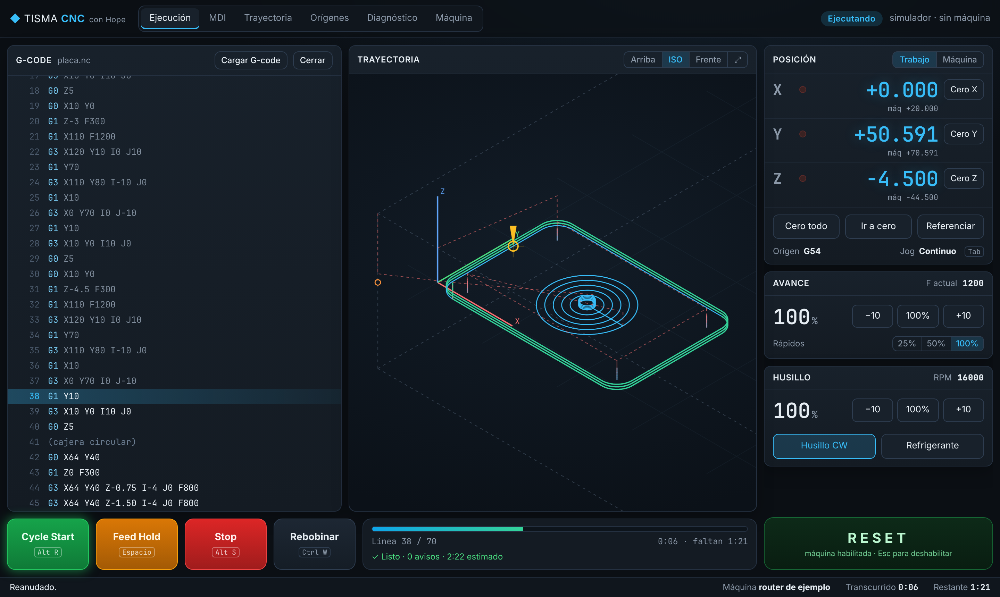
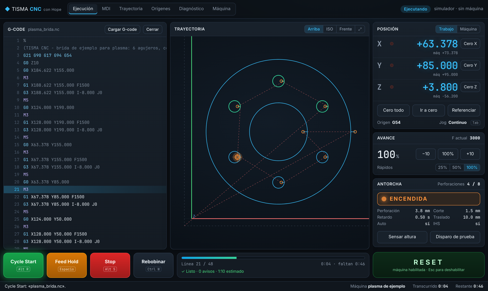

# TISMA CNC (Hope CNC): control CNC moderno como herramienta interna de Hope

**Objetivo:** reemplazar Mach3 con un programa que funcione igual en una PC vieja y en una
moderna, que **revise el programa antes de mover la máquina** y en el que Hope pueda ayudar
(revisar, simular, explicar errores) pero **nunca mover la máquina sin permiso humano**.

Código: `hope/cnc/`. Pruebas: `tests/test_cnc.py`. Máquina de ejemplo: `configs/cnc_maquina.yaml`.

## 1. Por qué Mach3 envejeció y qué se cambia

| Mach3 | Hope CNC |
|---|---|
| Genera los pulsos desde Windows por el puerto paralelo: depende de la latencia de la PC y de un driver de 32 bits | La PC **no genera pulsos**. Los genera un controlador de tiempo real (grblHAL, FluidNC, LinuxCNC con Mesa o con puerto paralelo) |
| Lo que se revisa no es exactamente lo que se ejecuta (macros, modos de Mach3) | Un **solo intérprete** (el de Hope) decide la trayectoria; al controlador le llega G-code normalizado y simple |
| Los errores aparecen con la máquina en marcha | **Revisión previa**: límites de recorrido (arcos incluidos), husillo, F faltante, códigos no soportados, tiempo real con aceleración |
| Solo Windows | Python en Windows, Linux o Raspberry Pi; el controlador puede ser USB o Ethernet |

## 2. Arquitectura

```
 G-code (CAM, Mach3)        configs/cnc_maquina.yaml
        │                            │
        ▼                            ▼
  gcode.py: intérprete ──► Program (ops en coordenadas de máquina, diagnósticos por línea)
        │
        ├─► planner.py: lookahead + trapecios ──► tiempo exacto, velocidades por tramo
        ├─► check.py:   límites, husillo, final ──► informe («LISTO» / «NO se puede enviar»)
        └─► dialect.py: G-code normalizado (grbl | linuxcnc)
                    │
        controller.py ── guardián: hardware.control (aprobación humana, ligada al hash)
                    │
        backends/: sim │ grbl (serie/TCP, conteo de caracteres) │ linuxcnc (API Python)
                    │
          tiempo real: grblHAL / FluidNC / LinuxCNC ──► drivers ──► motores
```

La **seta de emergencia** corta físicamente la potencia de los drivers. Ningún software, tampoco
este, la reemplaza.

## 3. Equipos viejos y modernos

| Equipo | Camino recomendado | Configuración (`controlador:`) |
|---|---|---|
| PC vieja con **puerto paralelo** y la placa de conexión de Mach3 | LinuxCNC (ISO de linuxcnc.org, StepConf); mismos cables | `tipo: linuxcnc` |
| PC vieja **sin** buen tiempo real, o laptop | grblHAL/FluidNC por USB: la PC solo envía líneas, así que sirve casi cualquier equipo | `tipo: grbl`, `puerto: /dev/ttyUSB0` o `COM3` |
| PC moderna o mini PC | grblHAL por Ethernet (Teensy 4.1, placas BTT/PicoCNC), o LinuxCNC con Mesa 7i96S/7i76E | `tipo: grbl`, `puerto: tcp://IP:23`, `bufer: 1024` |
| Raspberry Pi 4/5 | LinuxCNC (imagen para Pi) o grblHAL por USB | igual que arriba |
| Sin hardware | Simulador | `tipo: sim` |

Para pasar los datos de Mach3: en *Config → Motor Tuning*, «Steps per» → `pasos_mm`,
«Velocity» → `vel_max` (mm/min) y «Acceleration» → `acel` (mm/s²). Los límites de *Homing/Limits*
van en `min`/`max`.

## 4. Qué hay en la v0

* **Intérprete** (`gcode.py`): G0/G1/G2/G3 (IJK, R, vueltas con P, helicoidales), G4, G17–G19,
  G20/G21, G90/G91, G90.1/G91.1, G28/G30, G53, G54–G59, G10 L2/L20, G92/G92.1, G43 Hn con tabla de
  herramientas, G43.1, G49, G61/G64, G98/G99 y los ciclos de taladrado G81/G82/G83/G73 (expandidos,
  así funcionan también en grbl). M0/M1, M2/M30, M3/M4/M5, M6, M7/M8/M9, comentarios, `(MSG, …)` y
  borrado de bloque.
  Los códigos de Mach3 que no son estándar (G12/G13, G15/G16, G50/G51, G52, M98/M99) dan un
  **error claro** con la alternativa. Las macros de usuario (M100 en adelante) dan un aviso.
* **Planificador** (`planner.py`): el mismo modelo que grbl (desviación de unión, pasada hacia
  atrás y hacia adelante, trapecios), con tiempos exactos. Comprobado contra cálculos a mano.
* **Revisión** (`check.py`): envolvente en máquina y G54, límites de recorrido por línea, corte
  con husillo apagado, programa sin M2/M30, tiempo, distancias y herramientas.
* **Traducción** (`dialect.py`): G-code normalizado por dialecto. Al volver a interpretar la
  traducción salen **los mismos movimientos y el mismo tiempo** (hay una prueba de ida y vuelta).
* **Controladores**:
  * `sim`;
  * `grbl` (serie o TCP, conteo de caracteres, estados, `$#`, errores y alarmas explicados, `!`/`~`/reinicio);
  * `linuxcnc` (modo automático por la API).
* **Guardián**: ejecutar en una máquina real es `hardware.control` (nivel humano). La aprobación
  queda ligada a:
  * el hash del programa;
  * la máquina y el controlador;
  * la envolvente calculada con los **orígenes reales** leídos del controlador.

  Cada aprobación se usa una vez. Un programa con errores nunca llega al controlador.
* **Pausas**: M0 y el cambio manual de herramienta en grbl esperan al operador (Enter para
  seguir, «a» para abortar con reinicio).
* **Herramienta interna de Hope**: `⟦cnc: pieza.nc | maquina=… dialecto=grbl⟧` revisa en el
  sandbox y **no mueve nada** (`hte_cnc_v1`).

### Uso

```bash
python -m hope.cnc revisar pieza.nc --maquina configs/cnc_maquina.yaml
python -m hope.cnc traducir pieza.nc --dialecto grbl --salida pieza_grbl.nc
python -m hope.cnc estado
python -m hope.cnc enviar pieza.nc                       # crea la solicitud en el guardián
python -m guardian.cli approve <id> --by <tu-nombre>
python -m hope.cnc enviar pieza.nc --aprobacion <id>
```

Para grbl por puerto serie hace falta `pip install pyserial`. Por TCP no hace falta nada más.

## 5. Límites honestos de la v0

* **Sin probar en una máquina real.** El protocolo de grbl está probado contra un grbl simulado y
  LinuxCNC solo en el caso «no instalado». Primera prueba real: en el aire, con Z arriba y sin
  herramienta.
* Sin parámetros ni expresiones (`#1`, `[ ]`), subprogramas, compensación de radio G41/G42 ni
  tiempo inverso G93.
* Ciclos fijos solo en G17 y G90.
* Sin sondeo (G38.x). El referenciado, el jog y los ceros están en la app (§6).
* El tiempo usa el modelo trapezoidal de grbl. Con curva S (grblHAL, LinuxCNC 2.9 o posterior) la
  máquina real puede tardar un poco más.

## 6. App de PC (pantalla estilo Mach3)



Doble clic en **`TISMA CNC.bat`** (Windows) o `./tisma_cnc.sh` (Linux), o `python -m hope.cnc app`.
Abre una ventana propia (Edge/Chrome/Chromium en modo app; si no hay, el navegador). Solo necesita
Python 3.10+, `pyyaml` y, para grbl por USB, `pyserial`: nada de PyTorch ni placa de video, así que
corre igual en una PC vieja. La vista 3D usa canvas 2D (sin WebGL) y el listado de G-code es virtual
(rinde con cientos de miles de líneas). Sin `controlador:` configurado arranca con el **simulador**,
que ejecuta el programa en tiempo real con aceleración, pausas y overrides.

**Mismo uso que Mach3, con aspecto actual:**

| Mach3 | Hope CNC |
|---|---|
| Pantallas Program Run / MDI / Toolpath / Offsets / Diagnostics / Settings (Alt-1…6) | Ejecución / MDI / Trayectoria / Orígenes / Diagnóstico / Máquina (**Alt+1…6**) |
| DRO grande con «Zero X/Y/Z», «Ref All Home», «Goto Zero», «Machine Coord's» | Panel de posición con **Cero X/Y/Z**, Cero todo, Referenciar, Ir a cero (sube Z primero) y Trabajo/Máquina; LED de referenciado |
| Cycle Start (Alt-R), Feed Hold (Espacio), Stop (Alt-S), Rewind (Ctrl-W) | Iguales, con los mismos atajos |
| Botón RESET que parpadea en rojo; Esc = reset | Igual: la app arranca en RESET; pulsarlo habilita la máquina (en una real, con aprobación del guardián en la misma pantalla); **Esc** la deshabilita |
| Listado de G-code con la línea actual resaltada | Igual, con colores de sintaxis, líneas con error en rojo y seguimiento automático |
| Toolpath | Vista 3D (Arriba/ISO/Frente/Lado, girar, mover, zoom), corte hecho en verde, rápidos punteados, caja del recorrido de la máquina |
| FRO / SRO con +/−; rapid override | Avance y husillo −10/100%/+10 y rápidos 25/50/100 % (overrides en tiempo real de grbl) |
| Jog con flechas, RePág/AvPág, Mayús = rápido, Tab = panel de jog | Igual, con paso continuo o 0.01/0.1/1/10 y porcentaje de jog lento |
| MDI con historial | Igual (↑/↓), y cada línea se revisa contra los límites antes de enviarse |
| Load G-Code | «Cargar G-code» (Ctrl+O) o arrastrar el archivo: se revisa al cargar (errores, límites, tiempo) |

**Seguridad en la app:** el servidor escucha solo en 127.0.0.1 y rechaza un `Host` que no sea local.
Las acciones son POST con encabezado propio y JSON, así que otra página web no puede mandarlas.
Con una máquina real hacen falta dos aprobaciones, y las dos quedan en la auditoría del guardián:

* habilitar el modo manual, al salir de RESET;
* cada Cycle Start, ligada al hash del programa y a la envolvente calculada con los orígenes
  reales.

Probado: ver `tests/test_cnc_app.py`.

* Sesión con el simulador: progreso, pausa M0, overrides, jog continuo hasta el límite, ceros y
  referenciado.
* Conexión en vivo con un grbl falso con hilos: conteo de caracteres, estado, `$#`, `$J`, overrides
  y errores.
* Flujo de aprobaciones.
* Servidor y su seguridad.

En la app, LinuxCNC todavía se maneja con `python -m hope.cnc enviar` (la ventana en vivo cubre el
simulador y grbl/grblHAL/FluidNC).

## 7. Plasma



Con `tipo: plasma` (ejemplo completo en `configs/cnc_plasma.yaml`), M3 enciende la antorcha y M5 la
apaga. Z0 de trabajo es la superficie de la chapa.

* **Perforación automática** (`perforacion_auto: true`), para programas que no la traen. En cada M3
  se arma la secuencia:
  1. sensado de altura (IHS), si está activo;
  2. altura de perforación;
  3. antorcha encendida;
  4. retardo;
  5. bajada a la altura de corte.

  En cada M5 sube a la altura de traslado. Si el CAM ya genera la secuencia (SheetCam y otros),
  se deja en `false`.
* **Sensado de altura con cabezal flotante:** `G38.2`, y también el **`G31` de Mach3**, que es lo
  que sacan los postprocesadores de Mach3 para plasma. Después, `G10 L20 P1 Z-holgura` pone Z0 en
  la chapa *medida*.
  * La traducción envía el `G10 L20` al controlador, y las alturas siguientes quedan relativas a la
    chapa real, no fijas.
  * Para planificar y simular se supone el contacto donde se espera la chapa.
  * Para revisar los límites se usa el recorrido completo del sensado, que es el peor caso.
* **Revisiones propias de plasma:**
  * cantidad de perforaciones, que es lo que gasta los consumibles;
  * metros de corte con la antorcha encendida;
  * rápidos con la antorcha encendida;
  * perforaciones sin retardo antes de moverse;
  * cortes con la antorcha apagada.
* **Panel «Antorcha» en la app**, en lugar del de husillo:
  * estado ENCENDIDA o APAGADA;
  * perforaciones hechas sobre el total;
  * alturas y retardo configurados;
  * **Sensar altura**;
  * **Disparo de prueba** (0,3 s, con confirmación).

  En la trayectoria, las perforaciones se marcan en naranja y los avances sin cortar en gris.
* **No incluido:** el control de altura en marcha por tensión de arco (THC). Lo tiene que hacer el
  controlador, porque necesita tiempo real: grblHAL tiene complemento de plasma y LinuxCNC tiene
  QtPlasmaC. Tampoco hay compensación de sangría (kerf); la hace el CAM.

## 8. Marca y colores (tema TISMA)

La app se llama **TISMA CNC** (`BRAND` en `hope/cnc/session.py`). Todos los colores están en
variables de `hope/cnc/app/static/tema_tisma.css`: marca, acento, números de posición, botones de
ciclo, antorcha, fondo y paneles. Esas variables también pintan la vista de trayectoria.
**Los valores actuales son provisionales:** falta cargar la paleta oficial de TISMA.

## 9. Próximos pasos

1. App (§6): LinuxCNC en vivo, edición de la configuración y de la tabla de herramientas desde
   la pantalla, sondeo de largo de herramienta, mando (pendant) USB y modo claro.
2. **Importar el perfil XML de Mach3.** Necesita un `.xml` de ejemplo de tu máquina para no
   adivinar los nombres de los campos.
3. Sondeo G38.2 y herramienta de medición de largo; G41/G42; parámetros `#` y subprogramas
   `O…sub`.
4. Probar en hardware: grblHAL por USB y Ethernet, y LinuxCNC con puerto paralelo.
5. Opcional: firmware propio en RP2040/RP2350 (PIO para los pulsos, curva S). Solo vale la pena si
   grblHAL se queda corto.
6. Hope como asistente: explicar los errores del informe, proponer correcciones al programa o al
   postprocesador del CAM, y estimar el desgaste por herramienta. Siempre como propuesta para que
   la persona la revise.
